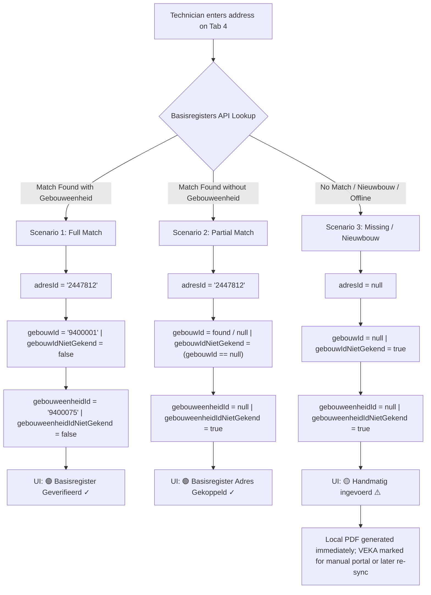

# Basisregisters Vlaanderen & VEKA API Specification
## Flemish Heating Certificate (Verbrandingsattest) Integration Blueprint

> **Status:** Authoritative Architectural Specification & Implementation Checklist  
> **Source Documents:** 
> - VEKA Confluence: `Locatie van een stooktoestel.doc`
> - VEKA Confluence: `meldingCentraleStooktoestellen.doc`
> - Digitaal Vlaanderen: Basisregisters Vlaanderen v2 REST API (`api.basisregisters.vlaanderen.be`)
> - Besluit van de Vlaamse Regering van 8 december 2006 (het *Vlaams Stooktoestellenbesluit*)

---

## 1. Executive Summary & Core Principles

1. **Zero Manual ID Entry for Technicians:**
   The technician is a heating engineer on site, not a database administrator. They must **never** be asked to manually type `adresId`, `gebouwId`, or `gebouweenheidId`. The application handles all querying, parsing, ID extraction, and flag derivation automatically.
2. **Tab Scope:**
   - **Tab 4 (`Klant` & Installation Location):** **Mandatory.** The appliance location must link to the Flemish Address and Building Registers.
   - **Tab 3 (`Firma - Technicus`):** **Out of Scope for Basisregisters IDs.** VEKA identifies the technician and HVAC enterprise solely via `ondernemingsnummer` (KBO) and `erkenningsnummer` (GV/TV).
3. **Offline & Nieuwbouw Independence (Fail-Safe):**
   Missing Basisregisters data (e.g. brand-new building not yet in CRAB, or no cellular reception in a basement) must **never** prevent generating or signing the combustion certificate. The A4 PDF is generated locally, while VEKA reporting handles the missing IDs gracefully via standard government fallback flags.

---

## 2. Flemish Basisregisters v2 Public API

Digitaal Vlaanderen provides free, public REST API endpoints requiring no authentication for standard volumes (API keys only needed for high-concurrency enterprise batching).

### 2.1 Primary Search Endpoint: `GET /v2/adresmatch`
Used to match street name, house number, postal code, and optional box number.

```http
GET https://api.basisregisters.vlaanderen.be/v2/adresmatch?straatnaam={straat}&huisnummer={nummer}&postcode={postcode}&busnummer={bus}
Accept: application/json
```

#### Example Response:
```json
{
  "adresMatches": [
    {
      "identificator": {
        "id": "https://data.vlaanderen.be/id/adres/2447812",
        "naamruimte": "https://data.vlaanderen.be/id/adres",
        "objectId": "2447812",
        "versieId": "2023-01-15T08:30:00+01:00"
      },
      "detail": "https://api.basisregisters.vlaanderen.be/v2/adressen/2447812",
      "gemeente": {
        "objectId": "21004",
        "detail": "https://api.basisregisters.vlaanderen.be/v2/gemeenten/21004",
        "gemeentenaam": { "geografischeNaam": { "spelling": "Brussel", "taal": "nl" } }
      },
      "postinfo": { "objectId": "1000", "detail": "https://api.basisregisters.vlaanderen.be/v2/postinfo/1000" },
      "straatnaam": {
        "objectId": "15200",
        "detail": "https://api.basisregisters.vlaanderen.be/v2/straatnamen/15200",
        "straatnaam": { "geografischeNaam": { "spelling": "Koning Albert II-laan", "taal": "nl" } }
      },
      "huisnummer": "20",
      "busnummer": "3",
      "volledigAdres": {
        "geografischeNaam": { "spelling": "Koning Albert II-laan 20 bus 3, 1000 Brussel", "taal": "nl" }
      },
      "adresStatus": "inGebruik",
      "score": 100.0
    }
  ]
}
```

### 2.2 Secondary Detail Endpoint: `GET /v2/adressen/{adresId}`
Used to obtain associated building units (`gebouweenheden`) and building IDs (`gebouwen`):
```http
GET https://api.basisregisters.vlaanderen.be/v2/adressen/{adresId}
Accept: application/json
```

Extracts:
- `gebouweenheden`: Array of building unit links (`https://data.vlaanderen.be/id/gebouweenheid/9400075`).
- `gebouw`: Primary building link (`https://data.vlaanderen.be/id/gebouw/9400001`).

---

## 3. Fail-Safe Decision Tree & Automated Flag Derivation

VEKA mandates three IDs for the installation location:
1. `adresId` (String, required for API)
2. `gebouwId` (String, optional)
3. `gebouwIdNietGekend` (Boolean, required)
4. `gebouweenheidId` (String, optional)
5. `gebouweenheidIdNietGekend` (Boolean, required)

The application derives these flags automatically using the following 3-scenario logic:



### Scenario Breakdown:

| Scenario | Condition | `adresId` | `gebouwId` | `gebouwIdNietGekend` | `gebouweenheidId` | `gebouweenheidIdNietGekend` | VEKA API Submission |
| :--- | :--- | :--- | :--- | :--- | :--- | :--- | :--- |
| **1. Full Match** | Standard address with registered building unit | `"2447812"` | `"9400001"` | `false` | `"9400075"` | `false` | **100% Automated** via `POST /meldingCentraleStooktoestellen` |
| **2. Partial Match** | Address exists, but building unit is unmapped | `"2447812"` | `"9400001"` or `null` | `false` or `true` | `null` | `true` | **100% Automated** (officially supported by VEKA) |
| **3. Nieuwbouw / Unregistered** | Brand-new street, unmapped parcel, or offline | `null` | `null` | `true` | `null` | `true` | **Local PDF valid;** VEKA reported via manual web portal fallback |

---

## 4. VEKA API JSON Request Specification

**Endpoint:**
`POST /meldingen-api-a2a/v1/extern/meldingCentraleStooktoestellen`

```json
{
  "externeReferte": "ATTEST-2026-0001",
  "ondernemingsnummer": "0123456789",
  "gegevensActiviteit": {
    "activiteitType": "Onderhoud",
    "datumActiviteit": "2026-11-10",
    "erkenningsnummer": "GV12345",
    "verwarmingType": "Individueel",
    "adresId": "2447812",
    "gebouwId": "9400001",
    "gebouwIdNietGekend": false,
    "gebouweenheidId": "9400075",
    "gebouweenheidIdNietGekend": false
  },
  "kenmerkenToestel": {
    "brandstof": "Aardgas",
    "nominaalVermogen": 24.5,
    "bouwjaar": 2021,
    "bouwjaarNietGekend": false,
    "fabricatienummer": "SN-98765432",
    "fabricatienummerNietGekend": false,
    "merk": "Vaillant",
    "merkNietGekend": false,
    "type": "ecoTEC plus",
    "typeNietGekend": false,
    "werking": "Condenserende ketel",
    "branderTechnologie": "Premix (GI)"
  },
  "eindbeoordeling": {
    "stooktoestelConform": "OK",
    "rookgasafvoerkanaalConform": "OK",
    "stookplaatsConform": "OK",
    "verbrandingscontrole": "OK",
    "toestelWerkingGoed": "Goed",
    "toestelWerkingVeilig": "Veilig"
  }
}
```

---

## 5. UI & UX Tactical Design

### 5.1 Status Badge on Tab 4 (`Klant`)
Located immediately beneath the installation address inputs:
- **Verified State:**
  ```
  [ 🟢 Basisregister Geverifieerd  ✓  ℹ️ ]
  ```
  - Background: Dark OLED base `#121212` with subtle emerald tint `rgba(46, 204, 113, 0.08)`.
  - Border: Tactical emerald green `1.0px`.
  - Icon: Green checkmark `Icons.check_circle_rounded`.
  - Action: Tapping opens the **Inspectievenster**.

- **Manual / Nieuwbouw State:**
  ```
  [ 🟡 Handmatig ingevoerd (Nieuwbouw / Niet geverifieerd)  ⚠️ ]
  ```
  - Background: Dark OLED base with subtle amber tint `rgba(241, 196, 15, 0.08)`.
  - Border: Amber gold `1.0px`.
  - Action: Tapping opens options to "🔍 Nu verifiëren in Basisregisters".

### 5.2 Inspection Bottom Sheet ("Inspecteer Overheids-IDs")
Tapping `[ 🟢 Basisregister Geverifieerd ✓ ℹ️ ]` presents a non-developer-friendly modal:

```
┌────────────────────────────────────────────────────────┐
│  Basisregisters Vlaanderen Identificatie           [✕] │
├────────────────────────────────────────────────────────┤
│  Officieel Adres:                                      │
│  Koning Albert II-laan 20 bus 3, 1000 Brussel         │
│                                                        │
│  • Adres ID (CRAB):           2447812            [📋]  │
│  • Gebouweenheid ID:          9400075            [📋]  │
│  • Gebouw ID:                 9400001            [📋]  │
│  • Status in Register:        In gebruik               │
│  • Match Betrouwbaarheid:     100% (Exacte match)      │
│                                                        │
│  [✓] Deze IDs zijn vergrendeld en klaar voor VEKA.    │
└────────────────────────────────────────────────────────┘
```

---

## 6. Implementation Checklist (Milestone 5 Slices)

### Phase 1: Domain & Service Core (Slice 5.1A)
- [ ] **Data Model:** Create `BasisregisterMatch` model with `adresId`, `gebouwId`, `gebouweenheidId`, `fullAddress`, `score`.
- [ ] **HTTP Service:** Create `BasisregistersService` using standard `http` package with 5-second timeout and offline detection.
- [ ] **Cache / Storage:** Ensure `service_locations` table stores `adres_id`, `gebouw_id`, `gebouweenheid_id`, and `verification_status`.
- [ ] **Unit Tests:** Mock HTTP responses for full match, partial match, and 0 matches.

### Phase 2: Tab 4 Klant UI Integration (Slice 5.1B)
- [ ] **Live Typeahead / Verification Trigger:** Add clean tactical search / autocomplete button or debounced suggestion list.
- [ ] **Address Selection Handler:** Auto-populate street, number, postal code, city, and silent storage of IDs.
- [ ] **Status Badge Component:** Implement `AddressVerificationBadge` with green checkmark / amber warning states.
- [ ] **Inspection Modal:** Implement `BasisregisterInspectionSheet` showing exact CRAB/Building IDs with copy buttons.
- [ ] **Zero Layout Shift:** Wrap badge in fixed height container to prevent jumping.

### Phase 3: VEKA Payload Generator & Tracker (Slice 5.2)
- [ ] **Payload Serializer:** Build `VekaPayloadBuilder` mapping visit snapshot to the exact `POST /meldingCentraleStooktoestellen` schema.
- [ ] **Automated Flag Logic:** Automatically set `gebouwIdNietGekend` and `gebouweenheidIdNietGekend` to `true`/`false`.
- [ ] **VEKA Status State Machine:** Implement transitions: `not_submitted` $\to$ `submitted_api` / `reported_manually_portal`.
- [ ] **Manual Fallback Dialog:** Add one-tap "Markeer als handmatig gemeld op VEKA portaal" for nieuwbouw visits.
