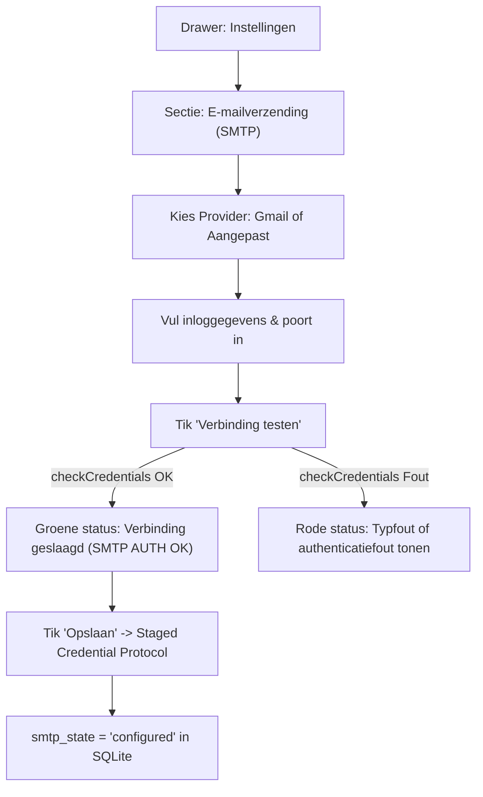
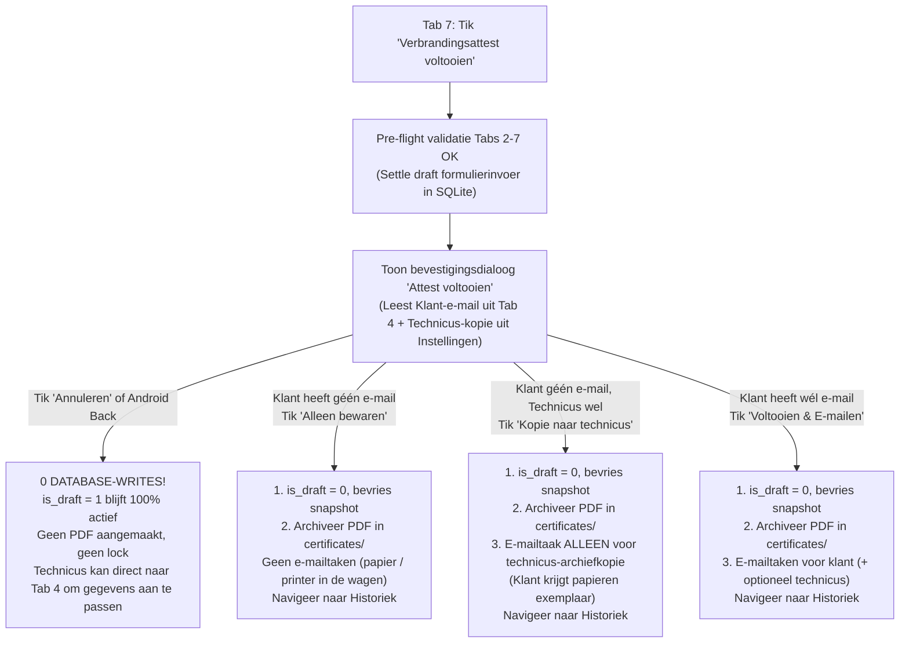
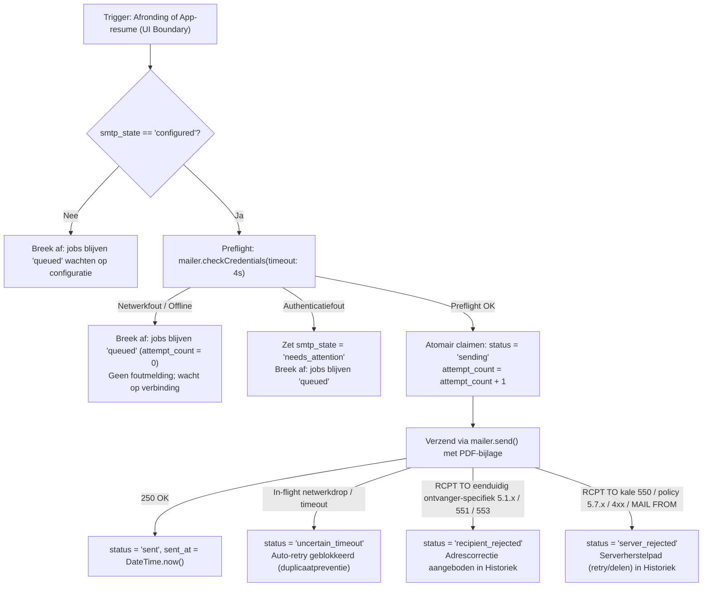

# Master Implementatiegids voor E-mailverzending en PDF-Archivering (Milestone 6)

Dit document beschrijft de architectuur, datalaag, veilige providerconfiguratie, offline outbox en acceptatietests voor het automatisch en betrouwbaar bezorgen van het officiële verbrandingsattest (A4 PDF) aan de **klant** en de **technicus**.

---

## 1. Productbeslissing: Locatie van E-mailinstellingen & Identiteit

1. **Locatie in de App: `Instellingen` (`AppletType.technicianSettings`):**
   * Alle uitgaande SMTP-configuratie (provider, host, poort, encryptie, inloggegevens, verbindingstest, automatisch verzenden en kopie-standaard) hoort thuis in de bestaande drawer-bestemming **Instellingen** (`AppletType.technicianSettings`).
   * **Tab 3 (*Firma - Technicus*)** binnen het verbrandingsattest blijft strikt gereserveerd voor firma- en technicusgegevens die wettelijk op het fysieke/digitale attest worden afgedrukt:
     - Bedrijfsgegevens: `company_name`, `street`, `house_number`, `box_number`, `postal_code`, `city`, `phone`, `email`, `kbo_number`.
     - Technicusgegevens: `technician_first_name`, `technician_last_name`, `gv_number` (gas), `tv_number` (stookolie).
   * Er wordt **geen** losse, aparte e-mailapplet aangemaakt in de navigatielade.
   * *Status Slice 6.1 UI:* Voltooid en geverifieerd. De SMTP-configuratiekaart (`EmailSettingsCard`) is ondergebracht in `TechnicianSettingsScreen` en gekoppeld aan de ladebestemming **Instellingen** (`AppletType.technicianSettings`) via het applet-compositiepunt `TechnicianSettingsApplet`. De layout gebruikt `WorkflowTabContainer` zodat de Bento-kaart bovenaan uitlijnt (12px top inset onder de AppBar) en de stijl exact overeenkomt met de Verbrandingsattest-tabs. Tab 3 (*Firma - Technicus*) is 100% vrij van e-mailinstellingen.

2. **Scheiding van SMTP Authenticatie en Zichtbare Afzender (`From:`):**
   * **SMTP Authenticatie-login (`technician_profile.smtp_username`):** De loginnaam die naar `SmtpServer(..., username: settings.username, password: ...)` wordt gestuurd. Dit is strikt een authenticatie-credential. Een aangepaste login mag een alfanumerieke account-ID zijn (bv. `cust_9821`) en is **nooit** automatisch een geldig afzender-e-mailadres.
   * **Formaat-gevalideerd Profiel-e-mailadres (`technician_profile.email`):** Het e-mailadres uit het bedrijfsprofiel (gemapt naar `firmaEmail` in PDF) is **formaat-gevalideerd** (syntaxiscontrole via regex bij invoer), maar **niet geverifieerd** via een externe mailbox-handshake.
   * **Afzender-Selectiebeleid van de App:**
     - Het adres voor `Message.from = Address(chosenSenderEmail, displayName)` wordt als volgt bepaald:
       1. **Gmail Provider:** `smtp_username` moet een formaat-gevalideerd e-mailadres zijn (bv. `@gmail.com` of Google Workspace). Dit adres wordt direct gebruikt voor `Message.from`.
       2. **Aangepaste SMTP:**
          - Indien `smtp_username` een formaat-gevalideerd e-mailadres is, wordt dit als zichtbare afzender gebruikt.
          - Indien `smtp_username` een account-ID is (zonder `@`), valt de app terug op het formaat-gevalideerde `technician_profile.email` als zichtbare afzender, *mits de SMTP-provider toestaat dat berichten onder dat afzenderadres worden verzonden*.
          - Indien noch `smtp_username` noch `technician_profile.email` een formaat-gevalideerd e-mailadres is, faalt de configuratievalidatie en blijft `smtp_state = 'unconfigured'` of `'needs_attention'`.
          - De app construeert **nooit** synthetische e-mailadressen uit gebruikersnamen en hostnamen (geen `smtp_username@<smtp_host>`).
     - **Doorgifte aan de Mailer-bibliotheek:**
       ```dart
       final String senderEmail = resolveSenderEmail(settings, profile);
       final message = Message()
         ..from = Address(senderEmail, profile.companyName.isNotEmpty ? profile.companyName : profile.technicianFullName)
         ..recipients.add(job.recipientEmail)
         ..subject = job.subject
         ..text = job.bodyText
         ..attachments.add(FileAttachment(File(job.pdfPath)));
       ```
     - **Provider-weigering & Onafhankelijkheid (Golden Rule #5):** Indien een relay een afzenderadres weigert (bv. *Sender address rejected*), blokkeert dit **uitsluitend de e-mailaflevering**. Het opslaan van het bezoek (`is_draft = 0`) en het archiveren van het PDF-certificaat in `certificates/` blijven te allen tijde 100% onafhankelijk en veilig bewaard.

3. **Per-bezoek Bevestiging & Historiek:**
   * Bij het afronden van een individueel bezoek bevestigt de technicus eenmalig de geadresseerden: de klant (afkomstig uit **Tab 4 (`Klant`)**; Tab 2 is `Start`) en de eventuele technicus-kopie.
   * De opvolging van de verzending, foutstatussen en herstelacties vinden plaats bij het betreffende attest in **Historiek**.

---

## 2. Technicus Workflow & Procesdiagrammen

### 2.1 Configuratie in Instellingen



### 2.2 Afronding van het Bezoek (Tab 4 als Bron, Eerlijke Knoppen & Geen Pop-up Invoervelden)

Het afrondingsvenster (`EmailRecipientDialog`) is puur een **bevestigingsvenster** en bevat **geen invoervelden**. Het venster is gestandaardiseerd onder de canonieke "BO2 Tactical HUD"-architectuur (`TacticalDialogWindow` en `TacticalDialogButton`), identiek aan de Basisregisters-dialoog:
- Donkere charcoal glass achtergrond (`AppColors.charcoalGlass`) met afgeronde hoeken (24px) en subtiele rand.
- Gecentreerde titel met signature gloeiende HUD-laserdivider (`TacticalLaserDivider` in antiek goud).
- Vaste sluitknop rechtsboven (`onClose: _onCancel`) en Android Back-afhandeling die 100% veilig annuleren zonder database-writes.
- Tactische pill-knoppen (`TacticalDialogButton.primary` in antiek goud en `TacticalDialogButton.secondary` in donker `#1E1E1E`).
- Volledig symmetrische kaarten (`CustomerRecipientCard` en `TechnicianRecipientCard`): identieke visuele opbouw met antiek gouden icoon links, 14px vette titel en 13px subtitel in het midden, en amber gouden vinkje rechts. Geen irrelevante telefoonnummers in de e-mailkeuze. Indien e-mail ontbreekt toont de kaart een tactische badge `[ Papier ]` en de toelichting dat het attest bewaard wordt voor fysieke bezorging (afdrukken in de wagen of post).

Tab 4 (`Klant`) is de enige bron van waarheid voor het e-mailadres van de klant. Dit voorkomt dubbele invoer en ondersteunt technici die met een mobiele printer in de auto werken (papier/post).



### 2.3 Outbox Preflight & Verzendingsbeslissingen



### 2.4 Monitoring & Herstel in Historiek

```mermaid
flowchart TD
    A["Historiek -> Selecteer Attest"] --> B["E-mail Leveringskaart"]
    B --> C{"Job Status?"}
    C -->|Geen taken (Alleen bewaren)| D1["Geen e-mailtaken voor dit attest\nActie: 'Alsnog e-mailen' -> Opent dialoog en maakt outbox-job\nActie: 'Attest delen' -> Printing.sharePdf fallback"]
    C -->|sent| D["Groene badge: Verzonden naar geadresseerden"]
    C -->|resolved_manually| E["Blauwe badge: Handmatig opgelost\n(Gestructureerd audit-record in resolved_at & resolution_notes)"]
    C -->|queued (wacht op config)| F["Actie: 'Configureer e-mail' -> Opent Instellingen"]
    C -->|queued (offline)| G["Actie: 'Nu verzenden' (of automatische verzending bij herstel)"]
    C -->|recipient_rejected| H["Actie: 'E-mailadres aanpassen' -> Update job en zet terug in 'queued'"]
    C -->|uncertain_timeout| I["Actie: 'Opnieuw proberen' (met duplicaatwaarschuwing)\nof 'Markeer als handmatig opgelost'"]
    C -->|server_rejected / failed| J["Actie: 'Opnieuw verzenden'\nof 'Delen via Android' (Printing.sharePdf fallback)"]
```

---

## 3. Kernprincipes & Architectuur

1. **Officiële 2-Lagen Architectuur & ViewModel Creatiegrens:**
   * **UI-Laag:** Zuivere weergavewidgets (`EmailSettingsCard`, `EmailConfirmationDialog`, `EmailOutboxCard`).
   * **Compositiepunt aan de Appletgrens:** Het compositiepunt voor het instellingen-applet (`TechnicianSettingsApplet` in `AppShellScreen`) roept `createTechnicianSettingsNotifier()` aan, beheert de levenscyclus en tijdige vernietiging (`dispose()`) van de notifier (inclusief het geval waarin de gebruiker wegnavigeert tijdens asynchrone initialisatie), en geeft de geïnjecteerde notifier door aan de pure weergavecomponent `TechnicianSettingsScreen(notifier: notifier)` en `EmailSettingsCard(notifier: notifier)`.
   * **Geen interne constructie in widgets:** Noch `TechnicianSettingsScreen`, noch `EmailSettingsCard` mag zelf databases (`AppDatabase`), repositories of SMTP-services construeren.
   * **Reactiviteit via `ChangeNotifier` & `ListenableBuilder`:** De UI luistert naar de `EmailSettingsNotifier` via standaard Flutter SDK `ListenableBuilder`. Er wordt geen externe state-package (zoals Provider of Riverpod), geen service locator (zoals GetIt), en geen extra architectuurlaag toegevoegd.
   * **UI-Boundary Lifecycle Trigger:** Het observeren van app-levenscyclusevents (`AppLifecycleState.resumed`) vindt plaats aan de UI-grens in `AppShellScreen`, die vervolgens `coordinator.processOutbox()` triggert. De data-laag implementeert zelf geen `WidgetsBindingObserver`.
   * **Data-Laag:** Repositories (`EmailSettingsRepository`, `EmailOutboxRepository`) en platformservices (`SecureCredentialStore`, `EmailSenderService`, `PdfArchiveService`).

2. **Wanneer is SMTP `configured`? (Lokale Volledigheid vs. Netwerkverificatie):**
   * `smtp_state = 'configured'` betekent uitsluitend dat de instellingen **lokaal volledig** zijn en er een credential in de KeyStore is opgeslagen. Het impliceert **niet** dat de SMTP-verbinding succesvol is getest of dat de afzender door de provider is geverifieerd.
   * De technicus mag instellingen te allen tijde opslaan **vóór** het uitvoeren van een verbindingstest.
   * Resultaten van de verbindingstest worden vluchtig getoond in de UI en worden niet persistent in SQLite bewaard (geen onnodige testhistorievelden).
   * Voorwaarden voor `smtp_state = 'configured'`:
     1. `smtp_provider` is geldig (`'gmail'` of `'custom'`).
     2. `smtp_host` is niet leeg en `smtp_port` is een geldig poortnummer (> 0).
     3. `smtp_username` is niet leeg en er is een geldig afzender-e-mailadres beschikbaar (geen synthetische adressen).
     4. `SecureCredentialStore` bevat een actieve, niet-lege sleutel (`smtp_password`).
   * Indien instellingen ontbreken: `smtp_state = 'unconfigured'`.
   * Indien instellingen aanwezig zijn maar de sleutel in de KeyStore ontbreekt of corrupt is: `smtp_state = 'needs_attention'`.

3. **Deterministisch Herstel voor Staged Credentials & Wisprotocol:**
   * SQLite en Android KeyStore kunnen **geen** gezamenlijke atomaire transactie vormen.
   * **Staged Protocol (`SecureCredentialStore` & `EmailSettingsRepository`):**
     1. Schrijf `smtp_password_staged` in KeyStore.
     2. Update SQLite instellingen en zet `smtp_state = 'staging'`.
     3. Schrijf `smtp_password` in KeyStore en wis `smtp_password_staged`.
     4. Update SQLite: `smtp_state = 'configured'`.
   * **Crash-veilig Wisprotocol (E-mailinstellingen wissen / Disconnect):**
     1. Technicus tikt op **E-mailinstellingen wissen**; dialoog toont toelichting dat de SMTP-verbinding en inloggegevens van dit toestel worden gewist, terwijl bedrijfs- en technicusgegevens, klanten, toestellen, bezoeken, PDF's en wachtrij-taken behouden blijven.
     2. Na bevestiging schrijft de app de reset SMTP-velden (provider = 'gmail', host = '', poort = 465, gebruikersnaam = '', auto_send = 0) en persisteert `smtp_state = 'clearing'` in SQLite. Statutair bedrijfse-mailadres en technicus-kopie blijven intact.
     3. Wis actief en staged wachtwoord in secure storage (`_secureStore.deletePassword()`).
     4. Finaliseer SQLite: zet `smtp_state = 'unconfigured'`.
     5. Succesmelding wordt uitsluitend getoond nadat zowel SQLite als secure storage de gewiste toestand hebben bereikt. Bij storing blijft de hersteltoestand intact en toont de UI een duidelijke foutmelding.
   * **Herstelmatrix bij Opstart (`recoverCredentialsState`):**
     * *Crash tijdens wissen (`smtp_state == 'clearing'`):* Bij opstart ruimt de repository eventuele achtergebleven wachtwoorden idempotent op via `deletePassword()` en finaliseert SQLite als `smtp_state = 'unconfigured'`.
     * *Crash vóór SQLite commit (verweesde staged sleutel):* SQLite staat nog op `unconfigured` of een bestaande `configured`. Bij opstart ziet de repository dat SQLite niet in `staging` staat en ruimt een eventueel achtergebleven verweesde `smtp_password_staged` veilig op via `discardStagedPassword()`, zonder het actieve wachtwoord of bestaande instellingen te wijzigen.
     * *Crash met SQLite in `'staging'` en `smtp_password_staged` aanwezig:* Promoot `smtp_password_staged` naar `smtp_password`, verwijder staged, en valideer opnieuw de lokale compleetheid (provider, host, poort > 0, gebruikersnaam, geldig afzenderadres). Zet SQLite op `'configured'` indien lokaal compleet, anders `'unconfigured'`.
     * *Crash met SQLite in `'staging'` maar `smtp_password_staged` ONTBREKEND:* Als SQLite in `'staging'` staat zonder staged sleutel, zet `smtp_state = 'needs_attention'`. Een ontbrekende staged sleutel mag NOOIT worden behandeld als bewijs dat een eerder actief wachtwoord past bij de nieuwe instellingen. De technicus moet het wachtwoord opnieuw invoeren.
     * *Actieve sleutel ontbreekt bij `smtp_state == 'configured'`:* Indien bij controle van een geconfigureerd profiel `smtp_password` `null` of leeg blijkt te zijn in de KeyStore, zet `smtp_state = 'needs_attention'`. Automatische verzending blijft geblokkeerd tot herstel.

4. **Typen van Service-Uitkomsten & Lokalisatie:**
   * `EmailSenderService` retourneert uitsluitend strikt getypeerde enumeraties en resultaatmodellen (bv. `SmtpConnectionResult`, `SmtpSendResult`), **nooit** hardcoded Nederlandse foutteksten.
   * De UI-laag (ViewModel / Notifier) vertaalt getypeerde resultaten naar Nederlandstalige teksten uit `AppDictionary` of gerichte feature-dictionaries (`lib/app/localization/email_delivery_dictionary.dart`), conform `AGENTS.md`.

5. **Android Back-up Regels & Exclusie (`flutter_secure_storage: ^9.2.2`):**
   * Android Auto-Backup kan versleutelde SharedPreferences herstellen naar een nieuw toestel of na een herinstallatie waar de KeyStore-hoofdsleutel niet meer bestaat, wat leidt tot fatale crashes (`KeyStoreException`).
   * De documentatie van `flutter_secure_storage` v9.2.2 specificeert `path="FlutterSecureStorage"` (zonder extensie) voor de SharedPreferences-uitsluiting in `backup_rules.xml`. De huidige codebase bevat `FlutterSecureStorage.xml`.
   * **Verificatiestatus:** Deze uitsluiting geldt als **onbevestigd (unverified)** totdat het exacte pad is gevalideerd tegen de runtime van de package of via een end-to-end back-up- en hersteltest op een fysiek Android-toestel of emulator.

6. **Preflight Nuance (`mailer.checkCredentials`):**
   * `mailer.checkCredentials()` test uitsluitend de netwerkverbinding en de geldigheid van het SMTP AUTH-handshake op dat specifieke moment. Het test **niet** of een latere e-mail met het geselecteerde `From`-adres door de provider zal worden geaccepteerd.
   * Een geslaagde preflight is **geen garantie** dat een latere `send()` slaagt (latere weigering door serverquota, ongeldige geadresseerde, afzenderweigering, of verbroken verbinding tijdens het streamen van de PDF).
   * Eventuele provider-weigering van een afzenderadres is een verzenduitkomst (`send()`) en mag **nooit** het opslaan van het certificaat (`is_draft = 0`) of de PDF-archivering blokkeren (Golden Rule #5).
   * **Strikte Foutenscheiding:**
     - *Preflight fout:* Netwerk/timeout $\to$ server heeft bericht nooit gezien $\to$ jobs blijven veilig in `queued` met `attempt_count = 0`.
     - *In-flight fout tijdens `send()`:* Netwerkverlies tijdens verzending $\to$ onzekere uitkomst $\to$ job wordt `uncertain_timeout`. Automatische herhaling is geblokkeerd om duplicaten te voorkomen; handmatige herhaling vereist expliciete bevestiging van de technicus.

7. **Duurzaam Gestructureerd Audit-Record voor Handmatige Oplossing (`resolved_manually`):**
   * Wanneer een technicus een `uncertain_timeout` in *Historiek* handmatig markeert als opgelost:
     - `status`: wordt gezet op `'resolved_manually'`.
     - `failure_reason`: behoudt de eerdere classificatie (`'uncertain_timeout'`).
     - `last_error`: bewaart de exacte eerdere technische exceptie / foutmelding ongewijzigd.
     - `resolved_at` (TEXT, ISO-8601): registreert het exacte tijdstip van de handmatige ingreep.
     - `resolution_notes` (TEXT): bewaart de toelichting (bv. `"Manueel als verzonden bevestigd door technicus"`).
     - `sent_at`: blijft `NULL` (omdat de app de SMTP-aflevering niet zelfstandig heeft kunnen verifiëren).
   * De status `resolved_manually` blijft te allen tijde strikt gescheiden van `sent`.

8. **PDF-Archivering (`PdfArchiveService`):**
   * Staging vindt plaats in `certificates/staging/` binnen de applicatiedocumentenmap (zelfde bestandssysteem als `certificates/`).
   * Na `writeAsBytes(pdfBytes, flush: true)` controleert de service `length == pdfBytes.length`.
   * Unieke bestandsnaam met microseconden en sequentieteller (`visit_${visitId}_${sanitizedAttest}_v${microseconds}_${seq}.pdf`) onder Dart isolate-level `Lock()`.
   * Opstart-cleanup verwijdert oude verweesde `.tmp`-bestanden uit de staging-map.

---

## 4. Datalaag & Schema (SQLite v12 & v13 Migratie)

### 4.1 Schema v12 (Slice 6.1)
In Slice 6.1 werd de initiële tabel `email_delivery_jobs` aangemaakt en werden de SMTP-kolommen toegevoegd aan `technician_profile`.

```dart
// Migratie in AppDatabase.onUpgrade (oude versie < 12):
if (oldVersion < 12) {
  await db.execute('ALTER TABLE technician_profile ADD COLUMN smtp_host TEXT;');
  await db.execute('ALTER TABLE technician_profile ADD COLUMN smtp_port INTEGER;');
  await db.execute('ALTER TABLE technician_profile ADD COLUMN smtp_username TEXT;');
  await db.execute('ALTER TABLE technician_profile ADD COLUMN smtp_use_ssl INTEGER NOT NULL DEFAULT 1;');
  await db.execute("ALTER TABLE technician_profile ADD COLUMN smtp_provider TEXT NOT NULL DEFAULT 'gmail';");
  await db.execute('ALTER TABLE technician_profile ADD COLUMN email_auto_send INTEGER NOT NULL DEFAULT 1;');
  await db.execute('ALTER TABLE technician_profile ADD COLUMN email_copy_technician INTEGER NOT NULL DEFAULT 1;');
  await db.execute("ALTER TABLE technician_profile ADD COLUMN smtp_state TEXT NOT NULL DEFAULT 'unconfigured';");
  await EmailDeliverySchema.createTablesAndIndexes(db);
}
```

### 4.2 Schema v13 Migratiepad (Toegewezen aan Slice 6.3)
In **Slice 6.3 (Offline Outbox, Historiek & Deel-Fallback)** wordt de tabel uitgebreid met de gestructureerde auditkolommen voor handmatige oplossing:

```dart
// Migratie in AppDatabase.onUpgrade (oude versie < 13 in Slice 6.3):
if (oldVersion < 13) {
  await db.execute('ALTER TABLE email_delivery_jobs ADD COLUMN resolved_at TEXT;');
  await db.execute('ALTER TABLE email_delivery_jobs ADD COLUMN resolution_notes TEXT;');
}
```

Voor verse installaties (`DatabaseSchema.version = 13`) bevat `EmailDeliverySchema.createTablesAndIndexes`:
```dart
abstract final class EmailDeliverySchema {
  static Future<void> createTablesAndIndexes(DatabaseExecutor db) async {
    await db.execute('''
      CREATE TABLE IF NOT EXISTS email_delivery_jobs (
        id INTEGER PRIMARY KEY AUTOINCREMENT,
        visit_id INTEGER NOT NULL,
        recipient_type TEXT NOT NULL,
        recipient_name TEXT NOT NULL,
        recipient_email TEXT NOT NULL,
        original_recipient_email TEXT NOT NULL,
        subject TEXT NOT NULL,
        body_text TEXT NOT NULL,
        pdf_path TEXT NOT NULL,
        status TEXT NOT NULL DEFAULT 'queued',
        failure_reason TEXT,
        attempt_count INTEGER NOT NULL DEFAULT 0,
        sent_at TEXT,
        last_error TEXT,
        resolved_at TEXT,
        resolution_notes TEXT,
        created_at TEXT NOT NULL,
        updated_at TEXT NOT NULL,
        FOREIGN KEY (visit_id) REFERENCES maintenance_visits (id) ON DELETE RESTRICT
      );
    ''');

    await db.execute('CREATE INDEX IF NOT EXISTS idx_email_jobs_status ON email_delivery_jobs (status);');
    await db.execute('CREATE UNIQUE INDEX IF NOT EXISTS idx_email_jobs_visit_recipient ON email_delivery_jobs (visit_id, recipient_type);');
  }
}
```

---

## 5. Overzicht van de Slices (Milestone 6)

| Slice | Resultaat voor de technicus | Belangrijkste technische onderdelen |
| :--- | :--- | :--- |
| **Slice 6.1 · E-mailconfiguratie & Verbindingstest** | In **Instellingen** (`AppletType.technicianSettings`) configureert de technicus Gmail (App-wachtwoord) of Custom SMTP met opties voor automatisch verzenden en kopie naar technicus. Wachtwoorden worden veilig bewaard via een staged protocol tussen KeyStore en SQLite v12 (`smtp_state`). Een knop test de verbinding via `checkCredentials()` met directe tactische feedback, en een discrete actie **E-mailinstellingen wissen** met bevestigingsdialoog ontkoppelt de account via een crash-veilig wisprotocol (`clearing` -> `unconfigured`). *(Status: Voltooid en aanvaard op Android — UI ondergebracht in Instellingen via TechnicianSettingsApplet compositie, top-uitlijning via WorkflowTabContainer matching Verbrandingsattest styling, getypeerde service-uitkomsten, constructor-geïnjecteerde notifier, ontkoppelactie met bevestigingsdialoog, 358/358 tests slagen, 0 analyzer-meldingen; live Gmail SMTP AUTH en herstartpersistentie geverifieerd en goedgekeurd door eigenaar).* | `TechnicianSettingsApplet`, `EmailSettingsNotifier`, `EmailSettingsRepository` met opstartherstel & wisprotocol, `SecureCredentialStore` (`smtp_password_staged` / `smtp_password`), `EmailSenderService.testConnection` (`package:mailer ^7.2.0`), SQLite migratie v12, Android back-upregels XML en internetpermissie. |
| **Slice 6.2 · PDF-Archivering & Outbox Creatie** | Bij *Voltooien* bewaart `PdfArchiveService` een privé-kopie via `.tmp` staging in `certificates/staging/`, lengteverificatie en geversioneerde rename (`visit_<id>_<attest>_v<micros>_<seq>.pdf`) naar `certificates/` onder `package:synchronized` `Lock()`. Opstart ruimt verweesde `.tmp`-stagingbestanden op. Indien registratie in SQLite faalt, biedt een niet-wegklikbare dialoog herstel via `registerArchivedPdf` zonder hergeneratie (mits bestand op schijf bestaat), of veilige verwijdering met tweede bevestiging via `PdfArchivingCoordinator` die delegeert naar `PdfArchiveService.deleteUnregisteredArchiveFile` (asynchrone Dart bestands-APIs en padvalidatie binnen `certificates/`; toont `pdfDeleteFailedError` indien verwijdering faalt). Dialoog `EmailRecipientDialog` (**Ontvangers bevestigen**) toont ontvangers; jobs worden atomair en idempotent (`INSERT OR IGNORE`) ingevoegd in `email_delivery_jobs`. Bij wachtrijstoring biedt een expliciete, niet-wegklikbare retry-dialoog (**E-mailwachtrij mislukt**) herstel met identieke parameters of overslaan met neutrale info-feedback, waarbij het afgeronde bezoek en de PDF behouden blijven. *(Status: Voltooid en aanvaard op Android — 28 gerichte tests, 386/386 suite tests slagen, 0 analyzer-meldingen, alle bestanden <= 250 regels; geverifieerd en goedgekeurd door eigenaar).* | `PdfArchiveService.archiveCertificate`, `cleanupStagingFiles`, `deleteUnregisteredArchiveFile`, `package:synchronized` `Lock()`, `EmailRecipientDialog`, `PdfArchivingCoordinator.archiveAndUpdateStatus`, `registerArchivedPdf`, `createEmailJobs`, `EmailOutboxRepository.createJobs`, `VisitFinalization` integratie. |
| **Slice 6.3 · Voorgrond-Outbox, Historiek & Deel-Fallback** | De afronding op Tab 7 gebruikt één uniforme dialoog (**Attest voltooien**) met directe klant e-mailinvoer, technicus-kopie, "Alleen bewaren", "Voltooien & E-mailen" en 100% veilige "Annuleren" (0 DB writes, concept blijft actief). De app triggert de outbox vanuit `AppShellScreen` bij `AppLifecycleState.resumed` en opstart via `EmailDeliveryCoordinator.instance` onder een binnen het app-isolaat gedeelde lock. `EmailDeliveryCoordinator` voert preflight uit via `checkCredentials()` (preflight faalt $\to$ jobs blijven `queued` met `attempt_count = 0`), claimt atomair onder `Lock()`, bouwt MIME-bijlagen via `FileAttachment` en classificeert SMTP-reacties van de vergrendelde mailer-package (`classifyCommunicationException`: `RCPT TO` eenduidig permanente weigering `5.1.x`/`551`/`553` $\to$ `recipient_rejected`, kale `550`, `4xx` tijdelijke of `5.7.x` beleidsfouten en `MAIL FROM` $\to$ `server_rejected`, onbekende/onvolledige fouten $\to$ `uncertain_timeout`). In *Historiek* toont `EmailDeliveryCard` de statussen, handmatige verzending ("Nu verzenden"), in-place adrescorrectie (strikt voor eenduidig afgewezen adressen; kale 550, 4xx en beleidsfouten volgen serverherstel), handmatige retry met duplicaatwaarschuwing, `resolved_manually` met verplichte toelichting zonder fallback, reële SQLite v13 migratietest via `AppDatabase.onUpgrade`, zero-config asynchroon PDF-delen via `Printing.sharePdf`, en voor attesten zonder e-mailtaken de directe acties "Alsnog e-mailen" en "Attest delen" zodat de bezorgoptie nooit verloren gaat. *(Status: Geïmplementeerd, geauditeerd en geverifieerd — 431/431 suite tests slagen, 0 analyzer-meldingen, alle bestanden <= 250 regels; wacht op acceptatie op Android door eigenaar).* | `EmailDeliveryCoordinator.instance`, `EmailSenderService.classifyCommunicationException`, UI resume/startup trigger in `AppShellScreen`, conditionele outbox updates, `EmailRecoveryDialogs`, `EmailDeliveryCard`, `EmailEmptyOutboxView`, `PdfShareHelper`, `EmailJobTile`, reële SQLite v13 migratie, `Printing.sharePdf`. |

---

## 6. Volledige Acceptatietestmatrix

| Scenario | Handeling / Voorwaarde | Verwacht resultaat in UI en SQLite |
| :--- | :--- | :--- |
| **Verse installatie (v12)** | Start app op een nieuw toestel met v12 schema. | Tabellen aangemaakt inclusief `email_delivery_jobs` en 8 SMTP-kolommen in `technician_profile`. `smtp_state` is `'unconfigured'`. |
| **Databank upgrade (v11 -> v12)** | Voer migratie uit op bestaande v11 databank. | 8 SMTP-kolommen toegevoegd aan `technician_profile`, tabel `email_delivery_jobs` aangemaakt. Bestaande bezoeken en profieldata blijven 100% intact. |
| **Verse installatie (v13 - Slice 6.3)** | Start app op een nieuw toestel met v13 schema. | Tabel `email_delivery_jobs` bevat direct kolommen `resolved_at` en `resolution_notes`. |
| **Databank upgrade (v12 -> v13 - Slice 6.3)** | Voer Slice 6.3 migratie uit op bestaande v12 databank. | `ALTER TABLE email_delivery_jobs` voegt `resolved_at` en `resolution_notes` toe. Bestaande queued/sent jobs blijven 100% intact. |
| **Credential opslaan succes** | Sla geldige instellingen en wachtwoord op in Instellingen. | Staged password gepromoveerd naar active. `smtp_state` is `'configured'`. Instellingen correct in SQLite. |
| **Crash tijdens credential staging (staged key aanwezig)** | Proces stopt na SQLite update naar `'staging'` vóór promotie. | Bij herstart detecteert `recoverCredentialsState` de staging toestand, promoot de staged sleutel en herstelt `smtp_state` naar `'configured'`. |
| **Crash tijdens credential staging (staged key ontbreekt)** | SQLite staat in `'staging'` maar KeyStore heeft geen `smtp_password_staged`. | `recoverCredentialsState` zet `smtp_state = 'needs_attention'`. Geen aanname dat oud wachtwoord geldig is. Waarschuwing in UI toont dat wachtwoord opnieuw moet worden ingevoerd. |
| **Ontbrekende actieve sleutel in KeyStore** | `smtp_state` staat op `'configured'` maar KeyStore heeft geen actief wachtwoord. | `recoverCredentialsState` of verzendpoging detecteert ontbrekend wachtwoord en zet `smtp_state = 'needs_attention'`. Automatische verzending geblokkeerd. |
| **Verweesde staged sleutel (met of zonder profiel)** | `smtp_password_staged` bestaat in KeyStore maar SQLite staat niet in `'staging'` (of er is nog geen profielrij). | `recoverCredentialsState` detecteert de verweesde staged sleutel en wist deze (`discardStagedPassword`) zonder actieve inloggegevens of profieldata te wijzigen. |
| **KeyStore storing bij opslag** | `setStagedPassword` faalt door KeyStore fout. | Bewerking stopt direct; SQLite blijft onaangeroerd. UI toont foutmelding. |
| **E-mailinstellingen wissen succes** | Bevestig wissen in de ontkoppeldialoog. | SMTP-velden gereset, actief en staged wachtwoord gewist uit KeyStore, `smtp_state = 'unconfigured'`, `email_auto_send = 0`. Statutair e-mailadres, technicus-kopie en wachtrij-taken blijven 100% behouden. |
| **Crash tijdens wissen (`clearing`)** | Proces onderbroken na SQLite update naar `'clearing'`. | Bij herstart detecteert `recoverCredentialsState` de `'clearing'` toestand, wist eventuele sleutels idempotent en finaliseert `smtp_state = 'unconfigured'`. |
| **Verbindingstest geslaagd** | Tik op "Verbinding testen" met correcte inloggegevens. | `checkCredentials()` slaagt. Groene HUD-bevestiging (SMTP AUTH OK). |
| **Verbindingstest mislukt** | Tik op "Verbinding testen" met onjuist wachtwoord. | `checkCredentials()` faalt met getypeerde enum-fout. Rode foutmelding met specifieke toelichting uit dictionary. |
| **PDF staging onderbroken** | Schrijven van staging-PDF stopt voortijdig. | `stageFile.length() != pdfBytes.length` werpt exceptie; geen rename naar archiefpad. Bezoek blijft bewaard met `pdf_status = 'failed'`. Startup ruimt verweesde stagingfile op. |
| **Niet-geconfigureerde afronding** | Afronden bezoek terwijl `smtp_state != 'configured'`. | Bezoek wordt opgeslagen, PDF gearchiveerd, jobs worden aangemaakt in `status = 'queued'`. UI meldt dat verzending wacht op configuratie in Instellingen. |
| **Offline kelderbezoek** | Outbox runt zonder internetverbinding. | Preflight `checkCredentials()` faalt met netwerkfout. Coordinator breekt af. Jobs blijven in `queued` met `attempt_count = 0`. Geen foutmelding in Historiek anders dan 'In wachtrij (offline)'. |
| **In-flight netwerkverlies** | Netwerk valt weg tijdens actieve `mailer.send()`. | Job krijgt `uncertain_timeout`. Geen auto-retry. Handmatige retry vereist duplicaatbevestiging. |
| **Gelijktijdige claims (Concurrency)** | Meerdere triggers (afronding + resume) lopen parallel. | Atomair claimen met `UPDATE ... WHERE id = ? AND status = 'queued'` garandeert dat maximaal één worker een job claimt. Geen dubbele verzending. |
| **Crash tijdens actieve verzending (`status = 'sending'`)** | App crasht of wordt geforceerd afgesloten terwijl job de status `'sending'` heeft. | Bij volgende opstart detecteert de coordinator gestrande `'sending'` jobs en zet ze naar `'uncertain_timeout'`. Geen automatische hertriggering zonder menselijke controle. |
| **Onzekere aflevering handmatig opgelost** | Technicus kiest in Historiek "Markeren als handmatig opgelost" bij `uncertain_timeout`. | Job krijgt status `resolved_manually`. `resolved_at` wordt gevuld met ISO-tijdstip, `resolution_notes` met audit-toelichting. De eerdere technische fout in `last_error` en `failure_reason` blijft 100% behouden. Status wordt **nooit** stilzwijgend herschreven naar `sent`. |
| **Eenduidige recipient afwijzing** | Mailer ontvangt eenduidig ontvanger-specifieke permanente weigering (`5.1.x`, `551`, `553`). | Job gemarkeerd als `recipient_rejected`. Knop "Adres wijzigen" zichtbaar in Historiek. |
| **Server- of beleidsweigering (incl. kale 550)** | Server weigert met beleidsfout (`5.7.x`, `554`), tijdelijke fout (`4xx`), `MAIL FROM` weigering, of ambigue kale `550`. | Job gemarkeerd als `server_rejected`. Serverherstelpad (handmatige retry of delen via Android) in Historiek; geen misleidende actie "Adres wijzigen". |
| **Handmatige batchmodus (`email_auto_send == 0`)** | Voltooiing met auto-send uitgeschakeld. | Jobs blijven in `queued`. App-resume start geen verzending. Alleen handmatige knop "Wachtrij verzenden" triggert verwerking. |
| **Afzenderselectie: Gmail** | `smtp_username` is een formaat-geldig e-mailadres. | `Message.from` gebruikt direct `smtp_username`. |
| **Afzenderselectie: Custom SMTP met e-mail login** | `smtp_username` is een formaat-geldig e-mailadres. | `Message.from` gebruikt `smtp_username`. |
| **Afzenderselectie: Custom SMTP met account-ID** | `smtp_username` is alfanumeriek ID (zonder `@`), `technician_profile.email` is formaat-geldig. | `Message.from` gebruikt het profiel-e-mailadres. Provider-acceptatie is een verzenduitkomst (`send()`). |
| **Afzenderselectie: Geen geldig adres beschikbaar** | `smtp_username` is account-ID en profiel-e-mail is ongeldig of leeg. | Configuratievalidatie faalt (`smtp_state` blijft `'unconfigured'`). Verzending lokaal geblokkeerd; attest bewaren en PDF blijven 100% veilig. |
| **Afronden: Annuleren zonder database-mutatie** | Tik op "Annuleren" (of Android Back) in de afrondingsdialoog op Tab 7. | 0 database writes! `is_draft` blijft `1`, `pdf_status` blijft `'draft'`. Geen PDF aangemaakt. Technicus kan direct naar Tab 4 om gegevens aan te passen en te herstellen zonder "Opslaan mislukt" lock. |
| **Afronden: Alleen bewaren en later bezorgen via Historiek** | Kies "Alleen bewaren" bij het afronden op Tab 7. | Bezoek afgerond (`is_draft = 0`), PDF gearchiveerd. Geen e-mailtaken in outbox. In Historiek toont de leveringskaart "Alsnog e-mailen" (om alsnog een e-mailtaak aan te maken) en "Attest delen" (Android share sheet), zodat de bezorgoptie nooit verloren gaat. |
| **Back-up uitsluiting SharedPreferences** | Cloud-backup herstel op een nieuw toestel. | De uitsluiting richt zich op `FlutterSecureStorage` (zonder extensie). Blijft gemarkeerd als **onbevestigd** totdat een fysieke Android back-up/restore test aantoont dat de SharedPreferences daadwerkelijk uitgesloten zijn. |
