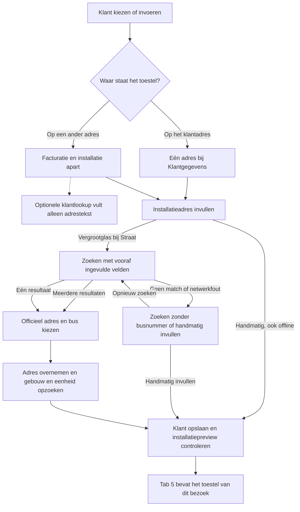
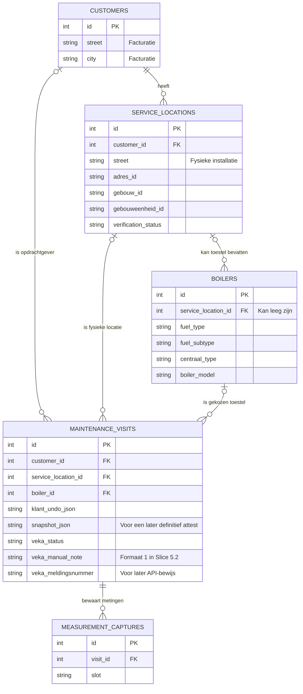
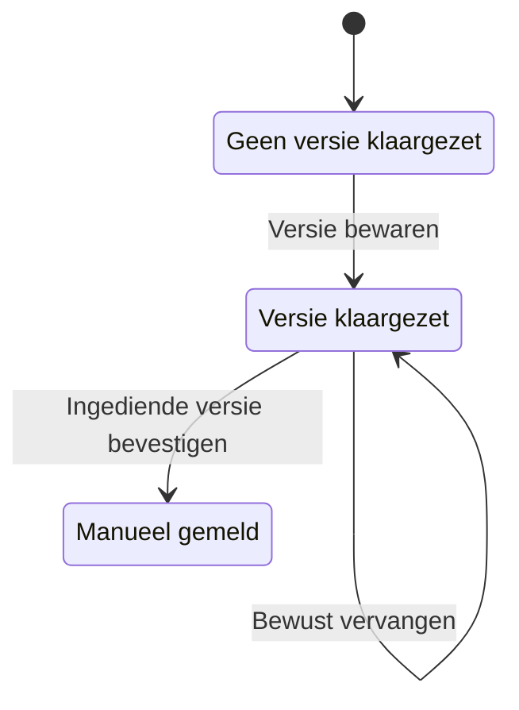
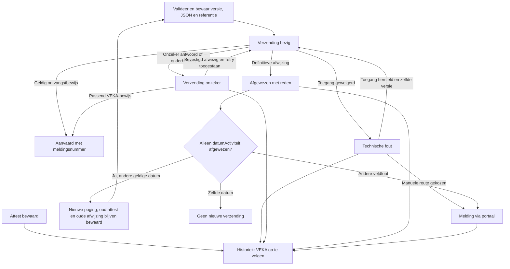

# Implementatiegids voor Basisregisters, stooktoestellen en VEKA

Dit document beschrijft wat een technicus doet, waar de app de gegevens bewaart en hoe elke stap wordt getest. De [roadmap](../ROADMAP.md#2-current-handoff-active-state-for-ai-agent) bepaalt de volgorde en de goedkeuring per slice.

| Fase | Resultaat voor de technicus | Startpunt |
| --- | --- | --- |
| **Slice 5.1 · Adres** | Fysieke installatie vinden, de officiële bus kiezen of het adres offline invoeren | Geïmplementeerd. De eigenaar bevestigde het hoofdpad op Android. Zie de roadmap voor de resterende controle en feedback op de resultatenlijst. |
| **Slice 5.2 · Manuele VEKA-opvolging** | Een bezoekversie lokaal vastleggen, dezelfde gegevens terugzien bij heropenen en een uitgevoerde portaalmelding bevestigen | Aanvaard na de Android-test van de eigenaar. |
| **Slice 5.3 · Historiek en herinneringen** | Eerdere bezoeken terugvinden en onderhoud opvolgen | Aanvaard na de Android-test van de eigenaar. |
| **Slice 5.4 · Opgeslagen ketel hergebruiken** | Een toestel kiezen op het geselecteerde installatieadres, inclusief bus | De eigenaar bevestigde het overnemen van de toestelgegevens op Android. |
| **Slice 5.5 · VEKA API-simulatie en herstel** | Een testmelding opvolgen, veilig herstellen en bewijs in Historiek terugvinden | Aanvaard na de Android-test van de eigenaar. |
| **VEKA API met beveiligde toegang** | Een echte melding versturen en de registratie bij VEKA terugvinden | Vereist een bevestigd API-contract en een beveiligde testverbinding buiten de app. |

Hoofdstukken 1–2 beschrijven het adres en het toestel. Hoofdstuk 3 bepaalt welke gegevens per bezoekversie worden bewaard. Hoofdstuk 4 legt de meldingsacties en de toekomstige API-koppeling vast. Hoofdstuk 5 bevat de acceptatiechecks.

## Voortgang van de implementatie

- [x] **Masterworkflow uitgewerkt.** De diagrammen, SQLite-veldkaart, JSON-voorbeelden en mocktestscenario's staan in deze gids.
- [x] **Basisregisters gebouwd (Slice 5.1).** Gedeeld en afzonderlijk adres, officiële busselectie, manuele invoer en herstel van een open klantbewerking.
- [x] **Toestel van het huidige bezoek opgeslagen.** Ketel- en brandergegevens staan in `boilers`. Het bezoek verwijst naar zijn toestel en installatieadres.
- [x] **Huidige code opnieuw automatisch gecontroleerd.** Alle 321 Flutter-tests slagen, de statische analyse meldt geen problemen en alle Dart-bestanden in `lib/` en `test/` blijven binnen 250 regels.
- [x] **Hoofdpad van de adresopzoeking op Android geprobeerd.** De selectie vulde het adres in en de installatiebadge werd groen.
- [x] **Busselectie en manuele wijziging opnieuw getest op Android.** Wisselen tussen bus `0001` en een andere bus werkte. Bij een handmatige wijziging schakelde het scherm direct naar **Handmatig ingevoerd**.
- [ ] **Overige Android-scenario’s en vergelijking met Basisregisters.** Zie de [roadmap](../ROADMAP.md#address-lookup-follow-up).
- [x] **Manuele VEKA-tracker mockklaar (Slice 5.2).** Preview, opslag en heropening van versie A, lokale bevestiging en gesimuleerde portaalstart zijn geïmplementeerd. De mock gebruikt een afzonderlijke SQLite-databank.
- [x] **Slice 5.2 op Android aanvaard.** De eigenaar bevestigde dat **Manueel gemeld** en het oorspronkelijke installatieadres behouden bleven na herstart van de mock-app.
- [x] **Historiek en herinneringen gebouwd (Slice 5.3).** Een voltooid attest wordt bevroren in SQLite en kan via het menu worden gezocht en geopend. Herinneringen gebruiken de bewaarde onderhoudsdatum en kunnen via Android worden gedeeld.
- [x] **Slice 5.3 op Android aanvaard.** De eigenaar testte Historiek en de lijst met aankomend onderhoud en gaf akkoord na de aanpassingen aan de VEKA-kaart.
- [x] **Ketelhergebruik gebouwd (Slice 5.4).** Tab 5 toont toestellen uit voltooide attesten op het bewaarde installatieadres en de exacte bus. Een bevestigde selectie kopieert de toestelgegevens naar het actieve concept.
- [x] **Slice 5.4 op Android aanvaard.** De eigenaar bevestigde dat de app de opgeslagen toestelgegevens overneemt. De geautomatiseerde tests dekken de exacte bus en het behoud van eerdere attest- en VEKA-gegevens.
- [ ] **Verwijderbeleid voor klanten met bestaande bezoeken.** Vandaag kan verwijderen gekoppelde locaties en ketels verwijderen en de verwijzingen op eerdere bezoeken leegmaken. Voltooide attesten en hun oorspronkelijke adres blijven leesbaar via de bewaarde versie. [SQLite-schema](../lib/core/database/database_schema.dart)
- [x] **VEKA API mockklaar (Slice 5.5).** De JSON-vertaling, het pogingenlogboek en het gesimuleerde transport zijn gebouwd. De tests controleren de bewaarde aanvraag, de ontvangstbevestiging, de afwijzing en herstel zonder dubbele verzending.
- [x] **VEKA-fouten zichtbaar en opvolgbaar in Historiek.** Onvoltooide meldingen staan bovenaan met een passende actie: starten, hervatten, uitkomst controleren, gegevens verbeteren of een portaalmelding opvolgen.
- [x] **Herstel na datumafwijzing bewaart het attest.** Alleen een afwijzing voor `datumActiviteit` kan na archivering via een nieuwe API-poging worden gecorrigeerd. Een ongewijzigde datum wordt geblokkeerd; de eerdere afwijzing en het ondertekende attest blijven intact.
- [x] **Automatische controle op dit herstel.** De suite bevat een test voor de zichtbare opvolging, een datumcorrectie na archivering en behoud van het oorspronkelijke attest en de vorige poging.
- [x] **Slice 5.5 op Android aanvaard.** De eigenaar voerde de verificatiestappen uit op Android en gaf akkoord op de werking van de API-simulatie, herstel en ontvangstbewijzen.
- [ ] **Beveiligde VEKA-verificatie.** Vraag toegang aan zodra de app klaar is. Controleer de veldwaarden, de beveiligde verbinding en een echt testmeldingsnummer tegen het portaal.

---

## Systeemdiagrammen

### 1. Technicus-stroomschema voor adres en toestel



Tab 5 mag ook eerst worden ingevuld. Tab 4 verandert de links naar klant en installatie op het bezoek en laat de bestaande ketelrij ongemoeid. Zie hoofdstuk 2.

### 2. Databankrelaties (SQLite)

De bezoekrij koppelt het toestel en het installatieadres onafhankelijk van elkaar. De schematische kolommen hieronder zijn een selectie. [Volledig SQLite-schema](../lib/core/database/database_schema.dart)



---

### 3. VEKA-toestandsdiagram voor Slice 5.2



De eerste twee toestanden gebruiken `maintenance_visits.veka_status = 'not_submitted'` en het schermlabel **Nog niet bevestigd**. Een lege of `null`-notitie betekent dat er nog geen versie is. Een geldig snapshot in `veka_manual_note` betekent dat een versie klaarstaat. Behandel een onleesbaar record of een status die niet met het bewijs overeenkomt als onleesbaar bewijs volgens §3.3. De derde toestand gebruikt `reported_manually_portal`. Zie §4.1 voor acties die de status ongemoeid laten, waaronder preview, het portaal heropenen en een melding in beraad laten.

---

## Hoofdstuk 1: Installatielocatie vastleggen

### 1.1 Status
**Status.** Geïmplementeerd in Slice 5.1 en getest met 274 geautomatiseerde tests. Het hoofdpad is op Android geprobeerd. Zie de [roadmap](../ROADMAP.md#owner-check-on-android) voor de resterende controles.

### 1.2 Gegevensscheiding: `customers` vs. `service_locations`
In de SQLite-databank zijn de klant en de fysieke installatielocatie strikt gescheiden:
* **Tabel `customers`:** Bevat uitsluitend contactgegevens en het facturatie-adres van de opdrachtgever (`company_name`, `last_name`, `first_name`, `street`, `house_number`, `box_number`, `postal_code`, `city`, `phone`, `email`, `notes`). Deze tabel bevat **geen Basisregisters ID-kolommen**.
* **Tabel `service_locations`:** Bevat het fysieke adres waar het stooktoestel daadwerkelijk is opgesteld (`street`, `house_number`, `box_number`, `postal_code`, `municipality`). **Alleen dit fysieke installatie-adres ontvangt Basisregisters identifiers:**
  - `adres_id`: Unieke sleutel uit het Adressenregister Vlaanderen (bv. `"2447812"`).
  - `gebouw_id`: Identificatie van het hoofdgebouw uit het Gebouwenregister (bv. `"9400001"`).
  - `gebouweenheid_id`: Identificatie van de specifieke eenheid/appartement (bv. `"9400075"`).
  - `verification_status`: Opgeslagen status (`verified`, `partial`, of `unverified`).

### 1.3 Adresmodi: Gedeeld vs. Afzonderlijk
* **Gedeeld adres (`Op het klantadres` — standaard):**  
  De technicus vult de klantgegevens in. Een tik op het vergrootglas `🔍` naast het veld `Straat` opent `AddressLookupDialog`. Bij selectie van een match vult de app de adresvelden van de klant in én worden de Basisregisters ID's gekoppeld aan het installatierecord in `service_locations`. De preview-kaart toont direct de verificatiestatus.
* **Afzonderlijk adres (`Op een ander adres`):**  
  Geschikt voor huurwoningen, bedrijven met een centrale administratie, of panden waarvan de eigenaar in een ander gewest (Brussel of Wallonië) woont.
  - Een opzoeking bij het klantadres vult via `populateCustomerAddressOnly` uitsluitend de vijf tekstvelden in en slaat geen overheids-ID's op.
  - De installatielocatie heeft een eigen opzoekknop die de Basisregisters ID's exclusief toekent aan de fysieke installatie.

### 1.4 Resultaataantallen, Appartementen en "Zoeken zonder busnummer"
Bij het bevragen van `GET /v2/adresmatch`:
1. **Nul kandidaten (0 matches):**  
   De dialoog toont *"Geen adres gevonden"*. Indien de technicus een busnummer had ingevuld, verschijnt direct de knop **Zoeken zonder busnummer**.
2. **Eén kandidaat (1 match):**  
   De match wordt **automatisch voorgeselecteerd** (`_selected = _matches.single`).
3. **Meerdere kandidaten (meer dan één match):**  
   - De dialoog toont de resultaten direct met straat, huisnummer en bus boven postcode en gemeente, zonder voorselectie (`_selected = null`).
   - De knop **Adres overnemen** blijft uitgeschakeld totdat de technicus expliciet een kandidaat kiest.
   - De Basisregisters API garandeert niet dat elke feitelijke bus reeds als afzonderlijke gebouweenheid is geregistreerd; de zoeklijst toont de gevonden officiële adressen en busnummers. Ook één adreskandidaat kan nog meerdere gebouweenheden hebben.
4. **Zoeken zonder busnummer:**  
   Beschikbaar nadat een zoekopdracht met busfilter is uitgevoerd. Een tik op **Zoeken zonder busnummer** wist het busfilter voor de API-query, maar **behoudt de getypte tekst in het businvoerveld**. De query keert terug naar de beoordeling van het resultaataantal (geen, één of meerdere matches). Kies alleen de kandidaat voor de echte stookplaats. Als de feitelijke bus ontbreekt, ga terug naar het formulier en bewaar het echte adres handmatig.
5. **Verrijkingstiming & API-Endpoints:**  
   Het ophalen van het gebouw- en eenheid-ID start **pas nadat de technicus tikt op "Adres overnemen"**. De service volgt de officiële Basisregisters v2 hiërarchie:
   - `GET /v2/gebouweenheden?adresobjectid={adresId}`: haalt de gekoppelde gebouweenheden op. Bij exact één gekoppelde eenheid wordt het ID pas gebruikt als het detailantwoord hetzelfde ID teruggeeft. Bij meerdere eenheden blijft het ID leeg.
   - `GET /v2/gebouweenheden/{gebouweenheidId}`: bevraagt het eenheidsdetail voor het veld `gebouw.objectId`. Indien alle eenheden eenduidig naar hetzelfde gebouw verwijzen, levert dit `gebouwId` op.  
   Bij het opzoeken van een louter facturatie/klantadres (`customers`) wordt deze detailverrijking overgeslagen.

### 1.5 De Drie Werkelijke Databankstatussen & Badgeteksten
Conform `basisregisters_models.dart`, `address_verification_badge.dart` en de SQLite-kolom `verification_status`:
1. **`verified` (Groene badge):**  
   Tekst: `Gekoppeld aan Basisregisters`. Vereist dat **alle drie de ID's aanwezig zijn**: `adresId`, `gebouwId` én `gebouweenheidId`.
2. **`partial` (Oranje badge):**  
   Tekst: `Adres gekoppeld · installatiegegevens onvolledig`. `adresId` is aanwezig, maar gebouw- of eenheid-ID ontbreekt of kon niet eenduidig worden gekoppeld.
3. **`unverified` (Neutrale / white54 badge):**  
   Tekst: `Handmatig ingevoerd ⚠ (geen Basisregister koppeling)`. Manuele invoer bij een offline bezoek of nieuwbouw. Overheids-ID's blijven `null`.

### 1.6 Handmatige invoer, onopgeloste koppeling en onbekend-vlaggen

- Handmatige invoer werkt zonder verbinding. Bewaar de vijf fysieke adresvelden. Als de technicus een veld van het effectieve installatieadres wijzigt of van adresmodus wisselt, verliest de eerdere ID-koppeling haar geldigheid. De app mag bij opslaan geen ID's van het vorige adres hergebruiken.
- Zoek een handmatig ingevoerd adres opnieuw in het VEKA-portaal. Als het adres daar echt onvindbaar is, bijvoorbeeld bij nieuwbouw, volg **Adres niet gevonden?** en vul de gevraagde adres- en contactgegevens in. Bevestig de melding in de app zodra de indiening in het portaal is teruggevonden. De rechtstreekse API-route vereist een officieel `adresId`. [Portaalhandleiding, stap 4](https://assets.vlaanderen.be/image/upload/v1738941186/Handleiding_testplatform_registreren_centrale_stooktoestellen_d3g6kf.pdf) · [VEKA API-voorwaarden](https://vo-veka.atlassian.net/wiki/spaces/TDV/pages/2400387096/meldingCentraleStooktoestellen)
- Een adresmatch met meerdere eenheden kan het gedeelde gebouw-ID opleveren als alle eenheden eenduidig naar datzelfde gebouw verwijzen. Het eenheid-ID blijft leeg. Ook een mislukte verrijking kan een geldig adres-ID met ontbrekende gebouwgegevens opleveren.
- Geen match, offline, een ambigue bus en een ontbrekend ID betekenen **onopgelost**. Bewaar ontbrekende ID's als `null`. Slice 5.2 registreert geen kaartverificatie. Het lokale dossier houdt de installatietekst en gevonden ID's bij.
- Voor een latere API-koppeling mogen `gebouwIdNietGekend` en `gebouweenheidIdNietGekend` alleen `true` worden na een expliciete controle op de officiële kaart en nadat die vaststelling is bewaard. Bij een aanwezig ID blijft de bijbehorende vlag `false`. Of een onopgeloste koppeling mag worden ingestuurd, wordt in het API-contract getoetst. [VEKA-velddefinitie](https://vo-veka.atlassian.net/wiki/spaces/TDV/pages/2400387096/meldingCentraleStooktoestellen)
- Basisregisters Vlaanderen dient voor Vlaamse adressen. Een klantadres in Brussel of Wallonië kan handmatig worden ingevoerd. Dat verandert niets aan het Vlaamse installatieadres. [Digitaal Vlaanderen](https://www.vlaanderen.be/digitaal-vlaanderen/onze-diensten-en-platformen/gebouwen-en-adressenregister/adressen-opzoeken)

### 1.7 Acceptatietests Hoofdstuk 1
*Voorwaarde:* Schone start van een draft en navigatie naar Tab 4 (*Klant*).

| Handeling | Gegevens gelezen of bewaard | Verwacht resultaat | Test | Status |
| :--- | :--- | :--- | :--- | :--- |
| **Normaal geval (Gemockte testdata):** Zoek gedeeld adres met busselectie | Leest query `Kerkstraat 10`. Bewaart `customers` adres en `service_locations` met alle 3 IDs (`verification_status = 'verified'`). | Velden ingevuld; preview toont groene badge `Gekoppeld aan Basisregisters`. | Voer in: straat `Kerkstraat`, nr `10`, postcode `9000` (gemockte testfixture). Kies bus `0101`. Tik op overnemen. | **[Huidig gedrag]** |
| **Live Android verificatie:** Reëel Vlaams adres | Bevraagt live Basisregisters v2 API met geverifieerd Vlaams adres. | Een officiële match vult de vijf adresvelden in. De badge volgt de daadwerkelijk ontvangen IDs volgens §1.5. | Voer in live app in: straat `Koning Albert I-laan`, nr `12`, postcode `8200` (Brugge). Bevestig overname. Zie [ROADMAP.md](../ROADMAP.md#owner-check-on-android). | **[Huidig gedrag]** |
| **Ambigue eenheid & Retry:** Meerdere bussen | Leest zoekopdracht met onbekende bus `bus 99`. | Geen directe match. Knop **Zoeken zonder busnummer** verschijnt. Getypte `99` blijft staan; keuzelijst toont kandidaten. Selectie activeert overnameknop. | Typ bus `99`. Tik op **Zoeken zonder busnummer**. Kies kandidaat uit lijst. Bevestig overname. | **[Huidig gedrag]** |
| **Gescheiden facturatie-isolatie:** Facturatie op ander adres | Leest klantadres en installatieadres apart. Klantlookup vult uitsluitend tekst in `customers`. | `service_locations` behoudt eigen adres en IDs; tabel `customers` bevat geen enkele overheids-ID-kolom. | Schakel naar `Op een ander adres`. Zoek klantadres `Veldstraat 1, 9000 Gent`. Controleer dat installatielocatie IDs onaangeroerd blijven. | **[Huidig gedrag]** |
| **Fout / Offline:** Geen internetverbinding | Leest manuele invoer. Bewaart tekst in `service_locations` met `verification_status = 'unverified'`. | Neutrale badge `Handmatig ingevoerd ⚠ (geen Basisregister koppeling)`. Geen crash. Overheids-ID's blijven `null`. | Schakel vliegtuigstand in. Typ `Dorpstraat 5, 9300 Aalst`. Sla op. | **[Huidig gedrag]** |
| **Heropeningscontrole:** App-herstart na adresinvoer | Wacht op afronding van de debounced SQLite-schrijfactie. Leest `service_locations` en `customers` na cold restart. | Exacte tekst en verificatiestatus (`verified`, `partial`, of `unverified`) worden foutloos hersteld. | Wacht tot de SQLite-save bevestigd is. Sluit app geforceerd af (`Kill`). Start app en heropen Tab 4. Controleer velden en badge. | **[Huidig gedrag]** |
| **Hangende Klant-edit & Annulatie:** Automatisch bewaren, herstarten en annuleren | Adreswijziging bereikt SQLite via debounced autosave; `klant_undo_json` blijft actief. App herstart. Technicus tikt op **Annuleren**. | SQLite herstelt oorspronkelijk adres en wist `klant_undo_json`. Tab 4 toont het herstelde adres. | 1. Wijzig adres in Tab 4. Wacht op debounced save. 2. Sluit app geforceerd af zonder 'Opslaan'. 3. Herstart app: sessie hersteld via `klant_undo_json`. 4. Tik op **Annuleren**. Controleer herstel van oorspronkelijk adres. | **[Huidig gedrag]** |

---

## Hoofdstuk 2: Stooktoestel kiezen en bewaren

### 2.1 Databronnen en koppelingen

- `boilers` bewaart de ketel en de brander. `fuel_type` bevat `gas`, `vloeibaar` of `vast`. `fuel_subtype` specificeert waar toepasselijk onder meer `aardgas`, `LPG`, `houtpellets` of `houtblokken`. Tab 6 leidt de meetvelden af van de brandstofkeuze in Tab 5. `centraal_type` bevat de B/C-keuze. `boiler_model` bevat de modelnaam. `is_central` alleen bepaalt de meldingsgeschiktheid niet.
- `maintenance_visits.service_location_id` wijst naar de fysieke locatie voor **dit bezoek**. `maintenance_visits.boiler_id` wijst naar het toestel voor dit bezoek. Attest en VEKA lezen die links voor het actuele bezoek. Ketelhergebruik vergelijkt de bewaarde installatieadressen en toestelgegevens uit voltooide attesten met het installatieadres van het concept.
- Opslaan in Tab 4 schrijft klant- en locatiegegevens waar nodig en past de bijbehorende bezoeklinks aan. Annuleren herstelt de bewaarde uitgangssituatie. Tab 4 verandert de ketelrij en de bezoeklink naar het toestel niet. [Databanklaag Klant](../lib/features/customers_installations/data/customer_repository.dart)

### 2.2 Volgorde van invoer en aanmaak van de ketelrij

`BoilerDraftRepository.getOrCreateActiveBoiler()` kan de ketel bij het initialiseren van het bezoek aanmaken, vóór de technicus Tab 5 opent. Bij die `INSERT` neemt de ketelrij de reeds aanwezige `maintenance_visits.service_location_id` over. Is die er nog niet, dan is `boilers.service_location_id` leeg. Een later bewaard installatieadres vult de bezoeklink aan. Deze twee paden moeten beide werken bij het samenstellen van het rapport. [Ketelrepository](../lib/features/certificate_draft/data/boiler_draft_repository.dart)

### 2.3 Paden bij nul, één of meerdere opgeslagen ketels

1. Bewaar het installatieadres in **Klant** en open **Opgeslagen toestel kiezen** in **Stooktoestel**. De lijst vergelijkt straat, huisnummer, bus, postcode en gemeente met de versie van het voltooide attest. Bij aanwezige officiële adres- of eenheid-ID's aan beide kanten moeten die overeenkomen. Bus `0001` en bus `1` gelden als verschillende waarden.
2. Bij een lege lijst keert **Nieuw toestel invoeren** terug naar het handmatige formulier. De technicus kan de specificaties invullen of de barcode scannen.
3. Bij één of meerdere opties toont de lijst het installatieadres en per toestel het merk, model, beschikbare serienummer en laatste bezoek. De technicus selecteert een toestel en bevestigt met **Toestel overnemen**.

### 2.4 Gegevensbehoud bij ketelhergebruik

- Overnemen vervangt de toestel- en brandergegevens van het actieve concept. De app bewaart de kopie samen met de koppeling aan het actuele bezoek in één SQLite-transactie. Eerdere attestversies en VEKA-gegevens blijven bij hun oorspronkelijke bezoek.
- Kies het toestel vóór je metingen, beoordeling, handtekeningen of VEKA-meldingsgegevens vastlegt. Bij bevestiging controleert de app opnieuw het concept en zijn installatieadres. [Ketelhergebruik](../lib/features/certificate_draft/data/saved_boiler_repository.dart)

### 2.5 Keuring voor eerste ingebruikname en periodiek onderhoud

Het bezoek bewaart de werkelijk uitgevoerde activiteit. Bij eerste keuring vereist ingebruikname een gunstig keuringsbesluit. Een eventueel hersteltraject bij afkeuring geeft op zichzelf geen toelating tot ingebruikname. Bij tekortkomingen na periodiek onderhoud gelden de herstelregels uit §4.3. Beide activiteiten kunnen een VEKA-melding vragen, ook bij een ongunstig resultaat. [Eerste keuring](https://www.vlaanderen.be/verplichte-keuring-van-een-nieuwe-of-gewijzigde-cv-installatie)

### 2.6 Acceptatietests Hoofdstuk 2
*Voorwaarde:* Actieve draft geopend in de app.

| Handeling | Gegevens gelezen of bewaard | Verwacht resultaat | Test | Status |
| :--- | :--- | :--- | :--- | :--- |
| **Normaal geval:** Invoer specificaties in Tab 5 | Bewaart merk, model, serienummer en brandstof in `boilers` op actief `boiler_id`. | Gegevens worden persistent bewaard in SQLite; gekoppeld aan draft-bezoek. | Vul in: merk `Buderus`, model `Logano plus`, serienummer `BU-887766`, vermogen `32 kW`. Wissel naar Tab 6 en terug naar Tab 5. | **[Huidig gedrag]** |
| **Ketelaanmaak bij opstart (vóór klantkeuze):** Schone start in Tab 5 | `BoilerDraftRepository.getOrCreateActiveBoiler()` initialiseert de ketelrij (`INSERT INTO boilers` met `service_location_id = null`). Bij latere klantselectie bewaart `maintenance_visits` `customer_id` en `service_location_id`. Ketelrij in `boilers` behoudt `service_location_id = null`. | Tab 5-specificaties blijven behouden; beide directe links (`maintenance_visits.boiler_id` en `maintenance_visits.service_location_id`) zijn geverifieerd; rapport preview combineert beide foutloos. | Vul Tab 5 in bij opstart. Ga naar Tab 4 en sla nieuwe klant op. Verifieer beide foreign keys op het bezoek en controleer behoud van data. | **[Huidig gedrag]** |
| **Locatie aanwezig bij aanmaak** | Maak in een repositorytest een bezoekrij met een locatie en zonder ketel. Roep `getOrCreateActiveBoiler()` aan. | De nieuwe ketel erft de locatie en `maintenance_visits.boiler_id` verwijst naar die ketel. | Controleer de twee bezoeklinks en de ketelrij in SQLite. | **[Huidig gedrag]** |
| **Ketel hergebruiken:** Zelfde installatieadres, verschillende bussen | Leest de installatieadressen en toestelgegevens uit voltooide attestversies. | Enkel toestellen op de bewaarde bus verschijnen. Na selectie en bevestiging bevat het concept de gekopieerde gegevens. | Bewaar een bezoek op bus `0001` en een bezoek op een andere bus. Open een concept op bus `0001`, kies het toestel en heropen het concept. Controleer ook het vroegere attest en de VEKA-gegevens. | **[Aanvaard op Android]** |
| **Behoud bij klantwissel:** Klant wijzigen in Tab 4 | Leest nieuwe klant. Laat `boilers` specificaties ongemoeid. | Ingevulde keteldata in Tab 5 blijft integraal aanwezig; ketel wordt niet gewist of verplaatst. | Vul Tab 5 in. Ga naar Tab 4 en kies een andere klant. Keer terug naar Tab 5: controleer dat alle velden nog exact gelijk zijn. | **[Huidig gedrag]** |
| **Heropeningscontrole:** App-herstart na ketelinvoer | Wacht op afronding van de debounced SQLite-save. Leest `boilers` na cold restart. | Alle ketel- en brandervelden worden volledig en zonder gegevensverlies hersteld. | Wacht tot de SQLite-save voltooid is. Sluit app geforceerd af (`Kill`). Herstart app en verifieer Tab 5. | **[Huidig gedrag]** |

---

## Hoofdstuk 3: Bezoekgegevens en blijvend meldingsbewijs

### 3.1 Bronnen per tab

| Invoer | SQLite-bron | Gebruik |
| --- | --- | --- |
| **Start en Firma – Technicus (Tabs 2–3)** | `maintenance_visits.activity_type` en `visit_date`. `technician_profile` voor bedrijf, KBO, naam en GV- of TV-nummer. | Activiteit, uitvoeringsdatum en de erkende technicus vastleggen zoals gebruikt voor deze versie. |
| **Klant (Tab 4)** | `maintenance_visits.service_location_id` → `service_locations`. `customer_id` → `customers` voor klant en facturatie. | VEKA gebruikt de fysieke installatie. Het facturatie-adres blijft bij de klant. |
| **Stooktoestel (Tab 5)** | `maintenance_visits.boiler_id` → `boilers`. | Bewaar de toestelkenmerken en relevante brandergegevens van deze versie. |
| **Meting (Tab 6)** | `maintenance_visits` voor bedrijfscondities, `smoke_index_bacharach`, `no_oil_trace_ok` en `verbrandingscontrole`. `measurement_captures` voor rookgasmetingen per `visit_id` en `slot`. | Attest en onderbouwing van de beoordeling. Rookgaswaarden worden per slot bewaard (`proef1`, `proef2_laaglast`, `proef2_hooglast`). De gepubliceerde VEKA-melding gebruikt de beoordeling. |
| **Eindbeoordeling (Tab 7)** | `maintenance_visits.toestel_werking_goed` en `toestel_werking_veilig`. Opmerkingen, hersteladvies, volgende datum en handtekeningen blijven bezoekgegevens voor het attest. | Gebruik de twee ingevulde eindoordelen en de drie keuzes in de kaart **VEKA-melding**. De kaart bewaart `stooktoestel_conform`, `rookgasafvoerkanaal_conform` en `stookplaats_conform` in SQLite. De oudere kolommen `overall_assessment` en `safety_conclusion` zijn geen bron voor deze veldkoppeling. |

### 3.2 Bewaargrens voor preview en nieuwe versies

1. Gebruik het ID van het geopende bezoek doorheen de hele actie. Wacht op de bestaande wachtrijen en op de relevante SQLite-schrijfacties uit Tabs 2–7. De datalaag moet een gesloten databank, een mislukte schrijfopdracht en een ontbrekende doelrij teruggeven als fout. Een afgewerkte debounce-timer telt pas wanneer de schrijfactie ook geslaagd is. Controleer de huidige save-methodes hierop. De meetrepository kan vandaag fouten inslikken.
2. Rond een actieve of herstelde Klant-bewerking eerst af via **Opslaan** of **Annuleren**. Wacht op de transactie die ook `klant_undo_json` afhandelt. Toon bij een open sessie **Sla je wijzigingen bij Klant op of annuleer ze.** Bestaande acties op A blijven beschikbaar.
3. Bewaar bedrijfscondities en gewijzigde meetsloten van één logische Tab 6-save in één transactie. Bewaar of verwijder alleen het betrokken slot via de bestaande meetrepository. Een fout in een slot rolt de hele save terug. Houd de bewerking beschikbaar voor opnieuw opslaan. Schrijf per tab alleen de eigen velden. Haal bij de Tab 6-save de conformiteitskeuzes en eindconclusies van Tab 7 uit de updatemap, zodat een eerder geladen meetmodel een nieuwer eindoordeel niet overschrijft. Lees daarna de bezoekgegevens via één consistente SQLite-lezing. Een laat afgewerkte save mag nooit naar een ander bezoek schrijven.
4. **Bekijk meldingsgegevens** toont die actuele versie en waar invoer ontbreekt. De actie schrijft geen meldingsversie of status. Voor een eerste reservering of vervanging valideert de app de versie volgens §4.1b en bewaart zij exact de waarden die in het referentiescherm worden getoond. Bij een mislukte lees- of schrijfactie toont de app een herstelbare fout. De bestaande reservering blijft behouden en de browser gaat niet open.
5. **Heropen VEKA-portaal** en **Bevestig indiening** lezen het opgeslagen snapshot rechtstreeks op bezoek-ID. Ze lopen niet door de bewaarlijn van het actuele bezoek. Een andere locatie, gewijzigd profiel, nieuwe metingen, een open Klant-edit of een inmiddels decentraal toestel in B mag A niet blokkeren of veranderen.

### 3.3 Opslagformaat van de manuele melding

| Record | Opslag en levensduur |
| --- | --- |
| **Aanpasbaar bezoek** | Bestaande tabellen en bezoeklinks. De huidige Test-PDF gebruikt deze data. Definitieve attesten krijgen later hun eigen bevroren `snapshot_json` volgens de architectuur. |
| **Klaargezette versie A** | `maintenance_visits.veka_manual_note` bevat versiebeheer, een uniek `snapshot_id`, bezoek-ID, tijdstip en een zelfvoorzienend `local_report_snapshot`. Status blijft `not_submitted`. Het snapshot bevat waarden en eventuele lokale IDs als identificatiehulp. Het referentiescherm heeft geen joins met gewijzigde bronrijen nodig. |
| **Manueel bevestigd** | Schrijf de status `reported_manually_portal` en `manual_confirmation_record` in één transactie. Leg vast wie lokaal bevestigt, het tijdstip van de bevestiging, optioneel het portaalnummer en het opgegeven indieningstijdstip. Bewaar de rapportwaarden van A ongewijzigd. |
| **Later API-bewijs** | Een apart, duurzaam pogingenlogboek koppelt de rapportversie aan het exact verzonden JSON en het ontvangen antwoord. Zie §4.4. |

Slice 5.2 mag meldingsgegevens bij een draft bewaren. Deze beperkte afspraak laat `is_draft`, `snapshot_json`, PDF- en e-mailstatussen en bezoeklinks ongemoeid. Zorg dat een nieuw bezoek een eigen bezoek-ID krijgt en dat opschoning een bezoek met meldingsbewijs niet ongemerkt verwijdert. Een oude versie die de app niet kan lezen blijft bewaard. Toon **Meldingsbewijs kan niet worden gelezen** en blokkeer vervanging, bevestiging en verzending voor die rij. Lees formaat 1 ook na een upgrade. Een nieuwe mapping verandert bestaand bewijs niet. [Flutter- en data-architectuur van dit project](../ARCHITECTURE.md)

Voorbeeld van `veka_manual_note` met synthetische gegevens. De veldgroepen dekken de referentie voor §4.2. De lokale bezoekdatum blijft `YYYY-MM-DD` en opgeslagen bevestigingstijdstippen hebben een tijdzone. Het record voor de bevestiging is `null` zolang de melding openstaat. Geen deel van dit voorbeeld dient als standaardwaarde voor echte bezoeken.

```json
{
  "format_version": 1,
  "local_report_snapshot": {
    "snapshot_id": "fixture-visit-42-a",
    "visit_id": 42,
    "reserved_at": "2026-06-01T09:00:00Z",
    "activity": {
      "activity_type": "onderhoud",
      "visit_date": "2026-06-01",
      "attest_number": "TEST-42"
    },
    "technician": {
      "company_name": "Voorbeeldbedrijf",
      "kbo_number": "0123456789",
      "technician_first_name": "Jan",
      "technician_last_name": "Voorbeeld",
      "recognition_number": "GV12345"
    },
    "installation_address": {
      "street": "Kerkstraat",
      "house_number": "15",
      "box_number": "0101",
      "postal_code": "9000",
      "municipality": "Gent",
      "adres_id": null,
      "gebouw_id": null,
      "gebouweenheid_id": null,
      "verification_status": "unverified"
    },
    "boiler": {
      "is_central": true,
      "centraal_type": "C",
      "fuel_type": "gas",
      "fuel_subtype": "aardgas",
      "heating_type": "individueel",
      "boiler_operation": "condenserend",
      "burner_technology": "premix",
      "boiler_brand": "Voorbeeldmerk",
      "boiler_brand_unknown": false,
      "boiler_model": "Voorbeeldmodel",
      "boiler_model_unknown": false,
      "boiler_serial_number": null,
      "boiler_serial_number_unknown": true,
      "boiler_construction_year": 2022,
      "boiler_construction_year_unknown": false,
      "boiler_nominal_power_kw": 32.0
    },
    "assessment": {
      "stooktoestel_conform": "OK",
      "rookgasafvoerkanaal_conform": "OK",
      "stookplaats_conform": "OK",
      "verbrandingscontrole": "OK",
      "toestel_werking_goed": "Goed",
      "toestel_werking_veilig": "Veilig"
    }
  },
  "manual_confirmation_record": null
}
```

Bij bevestiging bevat `manual_confirmation_record` de sleutels `snapshot_id`, `confirmed_by` (de lokale naam van de bevestiger), `confirmed_at`, `portal_reference` en `portal_submitted_at`. De laatste twee mogen `null` blijven. Het oorspronkelijke snapshot blijft leesbaar en behoudt zijn identiteit. De bevestiger en de uitvoerende technicus kunnen verschillende personen zijn. Toon het onderscheid op het referentiescherm. De technicus bevestigt de gegevens die hij in het portaal heeft gecontroleerd. Het snapshot is een lokale referentie, geen kopie van een antwoord van VEKA.

---

## Hoofdstuk 4: VEKA-melding opvolgen

### 4.1 Manuele tracker voor Slice 5.2

Plaats **VEKA-melding** als afzonderlijke sectie bij de afronding van het bezoek. Toon op een telefoon eerst het installatieadres inclusief bus, dan activiteit en datum, toestel, technicus en beoordeling. Zet **Bekijk JSON** achter een tweede actie. Laat expliciet zien of het installatieadres handmatig, gedeeltelijk of volledig gekoppeld is. Het scherm maakt duidelijk of de technicus de huidige invoer bekijkt of de eerder klaargezette versie gebruikt. Bied waar mogelijk een route naar het veld dat nog ontbreekt. Vertaal alle nieuwe labels via de bestaande woordenboeken.

| Actie | Voorwaarde en scherm | SQLite en browser |
| --- | --- | --- |
| **Bekijk meldingsgegevens** | Toon de actuele versie B na §3.2, met **Ontbreekt** bij lege invoer. Als A bestaat, link naar **Bekijk klaargezette versie**. | Geen wijziging aan meldingsstatus of bewijs. |
| **Bekijk klaargezette versie** | Toon A uit SQLite, inclusief het oorspronkelijke installatieadres, ook wanneer B of het profiel intussen is gewijzigd. | Alleen lezen. |
| **Open VEKA-portaal** | Eerste keer. Toon de geschikte versie en laat de technicus kiezen voor **Bewaar versie en open portaal**. | Wacht op succesvolle opslag van A. Open daarna de officiële URL in de systeembrowser. Status blijft **Nog niet bevestigd**. |
| **Heropen VEKA-portaal** | Toon dezelfde A als referentie. De technicus kan doorgaan in het bestaande portaalwerk. | A en status blijven ongewijzigd. Open alleen de vaste URL. De browser ontvangt geen rapport-JSON of ingevulde adresparameters. |
| **Vervang klaargezette versie** | Toon A en de relevante wijzigingen in B. Laat de technicus bevestigen dat voor A geen portaalinvoer bestaat. Als een dossier al bestaat of de technicus twijfelt, laat A staan en laat het dossier eerst controleren. | Valideer B volgens §4.1b. Bewaar B als nieuwe versie na de voorwaardelijke schrijfactie. Een volgende klik op **Heropen VEKA-portaal** toont B. |
| **Later bevestigen** | Gebruik deze actie bij twijfel, bij **In bewerking** of wanneer de uitvoerende erkende technicus een dossier nog moet valideren. | Laat A en **Nog niet bevestigd** staan. |
| **Bevestig indiening** | Vraag **Heb je deze versie ingediend en teruggevonden bij Gemelde activiteiten?** Toon A met activiteit, datum, adres en toestel. Voor een door een derde voorbereide melding wacht de technicus tot het portaal **Gevalideerd en ingediend** toont. Optioneel referentie en indieningstijdstip. | Bewaar bewijs en status samen. **Manueel gemeld** is een lokale verklaring van de technicus. Slice 5.2 leest geen portaalstatus uit. |
| **Bekijk bevestiging** | Toon de bewaarde versie en bevestiging. Toon **Gewijzigd na melding** zodra een vergelijking met de huidige opgeslagen meldingsvelden een verschil vindt. Vergelijk waarden, zonder snapshot-ID of tijdstempels. De badge en het bewijs blijven zichtbaar wanneer die vergelijking niet lukt. | Herhaalde bevestiging is een no-op. Correcties en intrekkingen lopen via het officiële portaal en vormen apart werk voor de app. |

Gebruik het [officiële VEKA-portaal](https://melding.veka.vlaanderen.be/) en de werkwijze uit de [VEKA-portaalhandleiding](https://assets.vlaanderen.be/image/upload/v1738941186/Handleiding_testplatform_registreren_centrale_stooktoestellen_d3g6kf.pdf). De technicus controleert in **Gemelde activiteiten** dat activiteit, datum, uitvoerder, toestel en fysieke locatie overeenstemmen. Het portaal kan op basis van de fysieke locatie zelf aanvullende officiële IDs bepalen. Als het dossier inhoudelijk afwijkt, laat de app A openstaan voor controle. Bij een browserfout na een geslaagde SQLite-save blijft A klaarstaan. Toon **Portaal kon niet worden geopend. Probeer opnieuw.**

**Gelijktijdige acties.** Schakel de knop meteen uit zolang dezelfde actie loopt. Controleer bij de schrijfactie in SQLite het bezoek-ID, de verwachte status en de snapshot-ID die de technicus zag, of de afwezigheid van een snapshot bij de eerste reservering. Bewaar deze controle en de update in dezelfde transactie. Bij een verouderd scherm, zoals bevestiging van A nadat B werd bewaard, toon de actuele opgeslagen versie en vraag een nieuwe beoordeling. Bij de eerste reservering mag alleen de geslaagde schrijfactie de browser openen. Bij bevestiging van dezelfde reeds bevestigde versie blijft het oorspronkelijke tijdstip intact.

### 4.1b Geschiktheid van een nieuwe of vervangende versie

- Ondersteun in deze slice het pad voor centrale toestellen op aardgas met GV en voor stookolie met TV. Routeer LPG voorlopig naar portaalcontrole totdat de bestaande CO-beoordeling voor LPG afzonderlijk is gecorrigeerd en getest (§4.3). Toon bij andere gevallen **Controleer dit bezoek in het VEKA-portaal** en geef aan welke informatie ontbreekt of nog niet wordt ondersteund. Een oningevulde centrale keuze of een brandstof buiten deze appdekking levert geen uitspraak over de wettelijke meldingsplicht. De preview blijft bruikbaar voor controle.
- Vereis een herkenbare, werkelijk uitgevoerde keuring of volledige onderhoudsbeurt, een geldige uitvoeringsdatum die niet in de toekomst ligt, het gekoppelde toestel en het fysieke adres met straat, nummer, postcode en gemeente. Bus blijft optioneel. Een manueel of gedeeltelijk gekoppeld adres volstaat voor het lokale portaalpad. Een ontbrekend officieel adres-ID verhindert latere rechtstreekse API-indiening.
- Vereis de voor deze appflow benodigde bedrijfs-, technicus- en toestelgegevens uit §4.2. Controleer KBO en GV/TV lokaal op formaat met bestaande validatie waar die beschikbaar is. De status van de onderneming en erkenning wordt door VEKA gecontroleerd. Bewaar een positief nominaal vermogen, een gekozen verwarmingstype, een ondersteunde brandstof en een gekozen condensatietype. Kies **Type verwarming** en **Condensatietype** in de kaart **VEKA-melding** op Tab 7. De keuzes blijven op de ketelrij bewaard. Vereis de brandertechnologie alleen voor gas, waar de app hiervoor invoer toont. Voor merk, model, serienummer en bouwjaar is de bestaande expliciete keuze **Onbekend** toegestaan. Leeg en onbekend blijven verschillend.
- Vereis de toepasselijke rubrieken en de conclusies uit §4.2 voor een volledige melding. Positieve en negatieve resultaten zijn geldige uitkomsten. De technicus kiest de drie conformiteitsoordelen in de kaart **VEKA-melding** in Tab 7. De rapportagerepository bewaart de keuzes in de bestaande kolommen. Hergebruik de bestaande bepaling van `verbrandingscontrole`, inclusief een expliciete beoordeling waar de app die ondersteunt, en de twee oordelen van Tab 7. Bij een gewijzigde brandstof moet de relevante beoordeling opnieuw gecontroleerd en bewaard zijn vóór reservering. Als een rubriek ontbreekt, verwijs naar de betreffende tab. De ruwe meetwaarden en handtekeningen blijven onder de bestaande attestregels vallen.
- Voer deze toets uit bij een eerste reservering of vervanging. Heropenen en bevestigen werken op het al bewaarde snapshot volgens §3.2. Een gewijzigde klant, toestelkeuze of brandstof in B beïnvloedt de bevestiging van A niet.

### 4.2 Veldkoppeling voor preview en toekomstig VEKA-request

Slice 5.2 toont een lokaal, leesbaar JSON-overzicht van de waarden in §3.3 en de bijbehorende VEKA-velden. Toon ontbrekende waarden als `null` in de JSON en **Ontbreekt** op het scherm. Toon de actieve of bewaarde waarden per groep `ondernemingsnummer`, `gegevensActiviteit`, `kenmerkenToestel` en `eindbeoordeling`, en daarnaast de fysieke adrestekst en koppelstatus. Laat de toekomstige `externeReferte` leeg. Bewaar voor de manuele tracker uitsluitend het lokale opslagformaat uit §3.3. Gebruik de openbare velddefinitie als referentie. De exacte omzetting naar een verzendbaar request hoort bij de latere API-koppeling. [Officiële velddefinitie](https://vo-veka.atlassian.net/wiki/spaces/TDV/pages/2400387096/meldingCentraleStooktoestellen)

| VEKA-veld of groep | Bron | Regel |
| --- | --- | --- |
| `ondernemingsnummer` | `technician_profile.kbo_number` | Normaliseer naar cijfers. Bewaar als tekst om een voorloopnul te behouden. |
| `gegevensActiviteit.activiteitType` | `maintenance_visits.activity_type` | `onderhoud` → `Onderhoud`. `eerste_ingebruikname` → `Keuring voor eerste ingebruikname`. |
| `gegevensActiviteit.datumActiviteit`, `erkenningsnummer` | `visit_date` en `technician_profile.gv_number` of `tv_number` | Uitvoeringsdatum en erkenning van de uitvoerder. Selecteer GV voor gas en TV voor stookolie. |
| `gegevensActiviteit.verwarmingType` | `boilers.heating_type` | Individueel, collectief of expliciet onbekend. Bevestig hoofdlettergebruik in het API-contract. |
| `gegevensActiviteit.adresId`, `gebouwId`, `gebouweenheidId` | De drie IDs van `service_locations` | IDs zijn tekst. Ontbrekend adres-ID blokkeert de API. Bij manuele opvolging wordt de fysieke adrestekst mee bewaard. |
| `gegevensActiviteit.gebouwIdNietGekend`, `gebouweenheidIdNietGekend` | Eventuele toekomstige expliciete kaartcontrole | Volg §1.6. Zolang deze vaststelling ontbreekt, zet de app geen vlag op `true`. |
| `kenmerkenToestel.brandstof`, `nominaalVermogen` | `boilers.fuel_type`, `fuel_subtype` en `boiler_nominal_power_kw` | Aardgas en stookolie zijn de eerste ondersteunde gevallen. De openbare tabel kent ook LPG en vaste brandstoffen. Uitbreiding volgt na controle van de beoordeling en de exacte contractwaarden. Vermogen in kW als getal. |
| `kenmerkenToestel.merk`, `type`, `fabricatienummer`, `bouwjaar` | `boiler_brand`, `boiler_model`, `boiler_serial_number` en `boiler_construction_year` | `type` is het model. Bouwjaar is een geheel getal. |
| `kenmerkenToestel.merkNietGekend`, `typeNietGekend`, `fabricatienummerNietGekend`, `bouwjaarNietGekend` | De vier corresponderende `boiler_*_unknown`-kolommen | Gebruik de uitdrukkelijke keuze bij het toestel. Een leeg veld levert geen onbekend-vlag op. Als een waarde aanwezig is, moet de bijbehorende vlag uitstaan. |
| `kenmerkenToestel.werking`, `branderTechnologie` | `boilers.boiler_operation` en `burner_technology` | Werking gebruikt lokaal `condenserend`, `niet_condenserend` of `onbekend`. Voor gas gebruikt de app `premix`, `niet_premix` of `ventilatorbrander`. Gebruik de bestaande brandstofafhankelijke invoer en toets de vereisten en omzetting vóór API-verzending. De app gebruikt GII waar de publieke tabel een GI-variant beschrijft. |
| `eindbeoordeling.stooktoestelConform`, `rookgasafvoerkanaalConform`, `stookplaatsConform`, `verbrandingscontrole` | Drie conformiteitskeuzes uit Tab 7 en verbrandingscontrole uit Tab 6 | Beoordelingen zijn tekst. De VEKA-tabel toont **Niet OK** en het voorbeeld gebruikt **NOK**. Verifieer de toegelaten vorm in het API-contract. |
| `eindbeoordeling.toestelWerkingGoed`, `toestelWerkingVeilig` | De twee kolommen uit Tab 7 in §3.1 | Goed of Niet goed. Veilig of Niet veilig. Bewaar de werkelijk vastgestelde uitkomst. |
| `externeReferte` | Later eenmaal gegenereerde en bewaarde referentie voor de API-poging | Vereis een unieke referentie. Het lokale `attest_number` blijft een afzonderlijk volgnummer. |

Het oude [API-notitiedocument](BASISREGISTER_AND_VEKA_API_SPECIFICATION.md) biedt achtergrond. Gebruik voor implementatie van endpoint, handmatige tracker en onbekend-vlaggen de officiële bronnen en de afspraken in deze gids.

### 4.3 Regelgeving die het ontwerp raakt

- Artikel 15, §7 beschrijft de melding van de kenmerken van het centrale toestel en de uitgevoerde keuring of volledige onderhoudsbeurt door de uitvoerder of zijn aangestelde. De melding gebeurt binnen **30 dagen** na uitvoering. Bij een te late melding blijft de actie beschikbaar. Bij een latere API-respons kan VEKA een waarschuwing teruggeven en de melding toch registreren. [Vlaamse Codex, artikel 15, §7 zoals opgenomen in de lijst van inbreuken](https://codex.vlaanderen.be/PrintDocument.ashx?datum=&geannoteerd=false&id=1041019&print=false)
- Verplicht periodiek onderhoud voor centrale gas- en stookolietoestellen geldt vanaf 20 kW, respectievelijk om de twee jaar en jaarlijks. Voor centrale toestellen op vaste brandstof geldt jaarlijks onderhoud. De termijn kan maximaal drie maanden worden verlengd met behoud van de oorspronkelijke datum als basis voor de volgende beurt. Deze onderhoudsgrens bepaalt op zichzelf niet of een uitgevoerde keuring gemeld moet worden. Een toekomstig herinneringsalgoritme bewaart de oorspronkelijke vervaldatum als basis en test dit afzonderlijk. [Vlaamse onderhoudsregels](https://www.vlaanderen.be/verplicht-onderhoud-van-uw-cv-installatie-centrale-verwarming)
- Bij tekortkomingen na periodiek onderhoud gelden de herstelregels voor bestaande toestellen. Eerste ingebruikname vraagt een uitdrukkelijke toelating in het keuringsrapport. [Vlaamse keuringsregels](https://www.vlaanderen.be/verplichte-keuring-van-een-nieuwe-of-gewijzigde-cv-installatie)
- De officiële verbrandingstabel vermeldt voor LPG een verhoging van 15 mg/kWh boven de gewone CO-grens voor gas. De huidige `CombustionStatutoryRules` gebruikt een uniforme grens voor gas. Verifieer en pas die regel aan in afzonderlijk meetwerk. De tracker rapporteert het opgeslagen oordeel en introduceert geen nieuwe meting of herberekening. Neem LPG in de ondersteunde trackerflow op zodra de aparte meetcorrectie is getest. [Officiële verbrandingswaarden](https://assets.vlaanderen.be/image/upload/v1647524890/Verbrandingswaarden_centrale_stooktoestellen_mbuj5y.pdf)

### 4.4 VEKA API-simulatie en latere beveiligde koppeling



1. **Voorbereiden.** Bouw eerst tegen een fake transport met synthetische data. De latere adapter maakt de payload volgens de dan bevestigde OpenAPI-specificatie en valideert activiteit, erkenning, onderneming en locatie. Bewaar per poging het bezoek-ID, de rapportversie, de unieke `externeReferte`, de contractversie, exact de uitgaande JSON en een tijdstempel vóór verzending. Gebruik SQLite en een apart pogingenlogboek. Bewaar ook de ontvangen statuscode, de response en de waarschuwingen of veldfouten. Houd manueel bewijs in zijn eigen record. Beperk het zicht op deze gegevens tot het bezoek en zet ze niet in algemene logs.
2. **Verzenden.** Bewaar `sending` en de poging atomair vóór de eerste `POST` naar `/meldingen-api-a2a/v1/extern/meldingCentraleStooktoestellen`. Controleer de opgeslagen status vóór verzending zodat snelle tikken hoogstens één verzoek starten. Ook een eventuele server die het verzoek doorstuurt moet dezelfde poging herkennen en een tweede POST voorkomen. Een reeds bevestigde portaalmelding of aanvaarde API-melding blokkeert een nieuwe verzending voor hetzelfde bezoek.
3. **Bevestigen.** Een 2xx met een geldig, niet-leeg `meldingsnummer` en een overeenstemmende `externeReferte` als VEKA deze terugstuurt, wordt `accepted_api`. Bewaar ontvangstbewijs, `veka_meldingsnummer` en status samen. Toon het nummer en eventuele VEKA-opmerkingen. Test met HTTP 201 en een waarschuwing naast succes. Gebruik bijvoorbeeld de synthetische response `{"externeReferte":"fixture-42-api-a","meldingsnummer":"TEST-42","opmerkingen":["Testwaarschuwing"]}`.
4. **Afwijzen.** Bewaar een definitieve veldafwijzing als `rejected_api` en toon `errors[].detail` bij de relevante invoer. Laat de technicus na correctie bewust een nieuwe versie en poging starten. Bewaar de vorige payload en afwijzing. Behandel authenticatie- en configuratiefouten afzonderlijk als technisch probleem en blokkeer nieuwe verzending totdat de oorzaak is opgelost. Alleen een antwoord dat aantoont dat de aanvraag niet verwerkt is, mag als definitieve afwijzing worden behandeld.
5. **Onzeker resultaat.** Een time-out, serverfout met onbekende uitkomst, mogelijk duplicaat, 2xx zonder geldig ontvangstbewijs of crash met `sending` op schijf leidt tot `timeout_uncertain`. Hetzelfde geldt als het antwoord binnenkwam maar de app het bewijs niet kon bewaren. Toon **Controleer de melding bij VEKA**. Zet automatisch herverzenden en manueel dubbel indienen uit tot verificatie. Schrijf bij herstart de onzekere status weg en bewaar de originele poging. Sluit de poging na een aantoonbare match met VEKA. Als een bevoegde controle bevestigt dat er geen dossier is en herverzenden is toegestaan, gebruik bij een bewuste herhaling exact dezelfde JSON en `externeReferte`. Een manuele vervolgmelding kan pas na afhandeling van de onzekere poging en na een afzonderlijke bewuste keuze. Controleer beide kanalen op open of bevestigd bewijs voordat een actie start. De afhandeling van de onzekere poging en de statuscontrole voor een vervolgstap gebruiken hetzelfde bezoek-ID. Verifieer later welke officiële zoek- of ondersteuningsroute die controle kan leveren.
6. **Toegang en echte controle.** Voeg een beveiligde service buiten de mobiele app toe voor de mTLS-sleutels en het leverancierscertificaat. Een leveranciercertificaat en een geldige KBO/GV/TV in de melding dienen verschillende controles. Vraag beveiligde toegang aan zodra de app klaar is voor die stap. Gebruik goedgekeurde testdata, controleer de ontvangen melding bij **Gemelde activiteiten** en vergelijk meldingsnummer, activiteit, datum, uitvoerder, toestel en installatieadres. Leg bij een verschil vast wat er afwijkt voordat de koppeling productieklaar wordt verklaard. [VEKA Meldingen API en beveiliging](https://vo-veka.atlassian.net/wiki/spaces/TDV/pages/2294841459/Meldingen%2BAPI)

#### Implementatie in Slice 5.5

- Met `VEKA_MOCK_PORTAL=true` opent **Bekijk testmelding** in de kaart **VEKA-melding** een controlescherm voor het installatieadres, de bus en de aanvraag. De simulatie ondersteunt volledig gekoppelde adressen met de drie officiële IDs en centrale toestellen op aardgas of stookolie. Het portaal blijft het beschikbare pad voor manueel of gedeeltelijk gekoppelde adressen. De mock bewaart zijn data in `hvac_veka_mock.db`.
- `veka_api_attempts` bewaart de oorspronkelijke versie, exacte aanvraag-JSON, contractversie, externe referentie en huidige uitkomst. `veka_api_dispatches` bewaart elke verzending onder die referentie, inclusief de status en het ontvangen antwoord. Het bewijs van het portaal blijft in `maintenance_visits`. Historiek leest het bewaarde bewijs op bezoek-ID. PDF en attestopslag hebben hun eigen status.
- **Testmelding aanvaard** toont een synthetisch meldingsnummer. **Testmelding afgewezen** bewaart de veldfout en de eerdere poging. Na archivering kan alleen een afwijzing die uitsluitend `datumActiviteit` noemt via API worden verbeterd; een nieuwe, geldige datum is verplicht. Elke andere veldfout krijgt geen API-correctiepad en kan via de bewuste portaalroute worden afgehandeld. De ondertekende attest-snapshot wijzigt niet.
- **Technische fout bij testmelding** simuleert een definitieve toegangsweigering en bewaart de aanvraag. **Opnieuw proberen na herstel** herhaalt na bevestiging dezelfde JSON en referentie zolang de meldingsgegevens gelijk zijn. Als de gegevens zijn gewijzigd, kan de technicus de actuele versie in het portaal melden. **Open VEKA-portaal** legt de portaalversie vast en blokkeert verdere API-verzending voor dat bezoek. Vóór livegebruik moet de beveiligde koppeling bevestigen welke antwoorden een definitieve weigering bewijzen.
- Na het bewaren van een attest toont **Historiek** onopgeloste VEKA-meldingen bovenaan met de eerstvolgende actie. Een aanvaarde melding met ontvangstbewijs verdwijnt uit de opvolglijst. Een onzekere melding biedt alleen controle; een mogelijk duplicaat blijft onzeker en wordt niet automatisch opnieuw verstuurd.
- **Grens van de mock:** dit voorkomt geen gelijkwaardige melding die op een ander toestel werd gestart. Of VEKA `externeReferte` als duplicaatbescherming gebruikt, moet nog in de beveiligde VEKA-testomgeving worden bevestigd.
- **Verificatie nu:** `flutter analyze --no-pub` zonder problemen; alle 321 Flutter-tests geslaagd; geen Dart-bestand in `lib/` of `test/` is langer dan 250 regels. De eigenaar moet de recovery-, onzekerheids- en datumcorrectiestappen nog op Android uitvoeren. Zie de roadmap voor de volledige teststappen.

#### Voorbeeldrequest voor de mock

Dit synthetische voorbeeld toont de publieke requestvorm. Het is een startfixture voor tests van serialisatie en opslag van de exacte verzonden bytes. Toets de definitieve veldwaarden en vereisten volgens §4.2 en §4.4 vóór echte verzending. Een manueel ingevoerd adres zonder officieel ID gebruikt de lokale portaalroute.

```json
{
  "externeReferte": "fixture-42-api-a",
  "ondernemingsnummer": "0123456789",
  "gegevensActiviteit": {
    "activiteitType": "Onderhoud",
    "datumActiviteit": "2026-06-01",
    "erkenningsnummer": "GV12345",
    "verwarmingType": "Individueel",
    "adresId": "12345",
    "gebouwId": "67890",
    "gebouwIdNietGekend": false,
    "gebouweenheidId": "67891",
    "gebouweenheidIdNietGekend": false
  },
  "kenmerkenToestel": {
    "brandstof": "Aardgas",
    "nominaalVermogen": 32.0,
    "werking": "Condenserende ketel",
    "branderTechnologie": "Premix (GI)",
    "merk": "Voorbeeldmerk",
    "merkNietGekend": false,
    "type": "Voorbeeldmodel",
    "typeNietGekend": false,
    "fabricatienummer": "TEST-12345",
    "fabricatienummerNietGekend": false,
    "bouwjaar": 2022,
    "bouwjaarNietGekend": false
  },
  "eindbeoordeling": {
    "stooktoestelConform": "OK",
    "rookgasafvoerkanaalConform": "OK",
    "stookplaatsConform": "OK",
    "verbrandingscontrole": "OK",
    "toestelWerkingGoed": "Goed",
    "toestelWerkingVeilig": "Veilig"
  }
}
```

### 4.5 Flutter-architectuur en wijzigingen in de API

- Gebruik de bestaande UI- en datalagen uit [ARCHITECTURE.md](../ARCHITECTURE.md). Het rapportagescherm en zijn ViewModel beheren acties, laadstatus en leesbare feedback. De rapportagerepository gebruikt bestaande SQLite-bronnen en beheert het consistent lezen, het snapshot en statusovergangen. Widgets bevatten geen SQL, adresparsing of VEKA-mapping.
- Hergebruik de bestaande klantwachtrij, databankverbinding, validatie, PDF-gegevensbronnen en Basisregisters-service. Gebruik de bestaande Material-widgets. Voeg één afgebakende browseractie toe die vervangbaar is in tests. Centraliseer de Nederlandstalige tekst via `app_dictionary.dart` en de bestaande featurewoordenboeken. Hou Dart-bestanden op maximaal 250 regels.
- Houd de snapshotdecoder per opslagversie en de externe contractmapper bij de rapportagedata. Isoleer wijzigingen aan een endpoint, enum of JSON-vorm in de service of mapper en zijn tests. Als de API nieuwe brongegevens vereist, breid dan gericht het formulier, de opslag en de tests uit. De decoder blijft historische formaten lezen. Verwerk optionele extra velden van externe antwoorden zonder crash. Valideer de velden die nodig zijn om een match of ontvangstbewijs betrouwbaar te herkennen. Een gewijzigd extern contract mag geen bestaande lokale bewijsrijen herschrijven.
- Deel foutmeldingen en acties met de bestaande schermconventies. Toon een retry voor tijdelijke fouten en een route naar het invoerveld voor herstelbare gegevens. Laat lokale opslag, PDF en e-mail hun eigen status en voorwaarden behouden. Neem de historiek en nieuwe rapportversies mee in tests van eventuele SQLite-migraties.

---

## Hoofdstuk 5: Bouwen, testen en overdragen

### 5.1 Huidige eigenaarstest op Android

Volg de vier stappen in de [roadmap](../ROADMAP.md#owner-check-on-android).

1. Zoek in gedeelde modus een Vlaams adres naast **Straat**. Controleer klantvelden en de installatiepreview.
2. Zoek een appartementsadres. Controleer dat **Adres overnemen** wacht op een keuze bij meerdere resultaten en dat **Zoeken zonder busnummer** de getypte bus behoudt tot je een officieel adres kiest.
3. Zoek eerst de afzonderlijke installatie en daarna het facturatie-adres. Controleer dat het installatieadres en de badge behouden blijven.
4. Typ offline een adres, verlaat de draft en heropen deze. Controleer de ingevoerde tekst en de handmatige badge.

### 5.2 Werkvolgorde na goedkeuring van Slice 5.2

| Volgorde | Lever op | Controle vóór de volgende stap |
| --- | --- | --- |
| 1 | Sluit de beoordeling uit Tab 6 aan op de bestaande modellen en maak de relevante saves afwachtbaar. Lees het volledige bezoek op ID. | Bevestig de opslag en herlezing van de zes rubrieken, gelijktijdige bewerkingen en rollback bij een fout in Tab 6. |
| 2 | Toon het overzicht en implementeer de versieopslag met de verwachte status en snapshot-ID. | Controleer in SQLite dat preview geen meldingsbewijs schrijft, en dat een bewaarde versie zelfstandig leesbaar is na herstart. |
| 3 | Sluit het referentiescherm, de vervangbare browseractie en de lokale bevestiging aan. | Test de overgangsmatrix hieronder en controleer onafhankelijkheid van de PDF. |

Deze stappen vormden de Slice 5.2-basis. Historiek, herinneringen en ketelhergebruik zijn in Slices 5.3–5.4 opgeleverd. Formele correcties in het portaal en echte VEKA API-verzending blijven apart werk en vereisen de afgesproken toegang en verificatie.

### 5.3 Acceptatiematrix voor lokale mocks

Gebruik synthetische fixtures en de bestaande Flutter-tests en `sqflite_common_ffi`. Vervang het portaal door een testfunctie die URL, aanroeptijdstip en eventuele fout registreert. Gebruik voor herstarttests een tijdelijke SQLite-databank op schijf, sluit haar en open haar met nieuwe repositories. Test de echte Android-procesherstart afzonderlijk. Voor elke meldingsactie controleert de test zowel de zichtbare feedback als de rij in SQLite.

| Scenario | Zichtbaar resultaat | Bewijs in SQLite of mock |
| --- | --- | --- |
| **5.1-regressie** · gedeeld of afzonderlijk adres, officiële bus, manuele wijziging en offline fallback | Een keuze bij meerdere resultaten is verplicht. Een ambigue eenheid blijft gedeeltelijk gekoppeld. | Een afzonderlijke klantlookup schrijft alleen facturatietekst. Een adreswijziging hergebruikt de oude IDs niet. Bij meerdere eenheden kan het gedeelde gebouw-ID blijven staan. |
| **5.1-regressie** · ketel ontstaat vóór of na de bezoeklocatie | Tab 5 behoudt invoer. De meldingspreview gebruikt het toestel en adres van het bezoek. | Controleer beide bezoeklinks. Alleen de creatie van een nieuwe ketel kan de bestaande bezoeklocatie overnemen. |
| **Onmiddellijke preview** · sla vermogen, beoordeling of meting op en ga direct naar de preview | Laatste opgeslagen waarden en expliciete **Ontbreekt**-labels. De preview toont ook negatieve oordelen en expliciet onbekende toestelkenmerken. | Actuele Tab 6- en Tab 7-rubrieken zijn ingelezen. Een late Tab 6-save mag de Tab 7-oordelen niet overschrijven. Metingen staan in hun eigen slot. Geen wijziging aan `veka_manual_note` of `veka_status`. |
| **Klant-edit overleeft herstart** · autosave B, heropen met `klant_undo_json` | Nieuwe preview of reservering vraagt **Opslaan** of **Annuleren**. Heropenen van bestaande A blijft mogelijk. Na annuleren toont de nieuwe preview het herstelde adres. | Undo en de opgeslagen A overleven herstart. Annuleren herstelt links en wist undo samen. |
| **Schrijffout** · gesloten DB, ontbrekende doelrij of fout na de eerste write van Tab 6 | Herstelbare fout. Opnieuw opslaan is beschikbaar. | Tab 6 rolt de bedrijfscondities én de slots van die actie terug. Geen nieuwe versie en geen browseraanroep. Een bestaande A blijft leesbaar. |
| **Klaarzetten en heropenen** · A = Kerkstraat 15, daarna B = Kerkstraat 25 en ander profiel | Eerste lancering blijft **Nog niet bevestigd**. Na herstart toont preview B. Heropenen toont A met het oorspronkelijke adres en profiel. | Browseractie gebeurt pas na commit. A bevat de oude tekst en oorspronkelijke identiteit. `manual_confirmation_record` blijft `null`. |
| **Browserfout of dossier te valideren** | Toon retry of **Later bevestigen**. Toon na retry dezelfde referentie. | Zelfde snapshot-ID en status. Geen tweede versie of bevestigingsrecord. |
| **Technische API-fout na archivering** | Historiek toont **Melding hervatten**. Na bevestigde toegangherstelling kan de technicus de opgeslagen melding opnieuw aanbieden. | De retry gebruikt exact dezelfde JSON en referentie. Beide dispatches blijven bewaard. |
| **Onzekere uitkomst of mogelijke duplicaatrespons** | Historiek toont **Uitkomst controleren**. Bied geen blinde retry of portaalactie aan. | Er is geen tweede dispatch voordat de technicus de uitkomst expliciet heeft gecontroleerd. Een bevestigde afwezigheid hergebruikt dezelfde JSON en referentie. |
| **Datumafwijzing na archivering** | Alleen een afwijzing die uitsluitend `datumActiviteit` noemt kan met een andere geldige datum worden verbeterd. Dezelfde datum kan niet opnieuw worden ingestuurd. | Nieuwe poging en nieuwe referentie; vorige request en response blijven behouden. `snapshot_json` van het ondertekende attest blijft ongewijzigd. |
| **Bewuste vervanging** · probeer eerst zonder bevestiging, daarna met geschikte B | Alleen expliciet vervangen toont vervolgens B. Een oud bevestigingsscherm van A vraagt om opnieuw te controleren. | Voorwaardelijke transactie verhindert verouderde bevestiging. Eerste reserveeractie opent de browser hoogstens één keer bij dubbele tik. |
| **Bevestig A terwijl B onvolledig of decentraal is** | Controleer A, bevestig en toon **Manueel gemeld**. Toon waar toepasselijk **Gewijzigd na melding**. | Bevestiging en status zijn atomair opgeslagen, met exacte snapshot-ID en oorspronkelijke waarden. Tweede tik en herstart behouden het tijdstip en bewijs. |
| **Niet-ondersteunde versie en offline adres** | Nieuwe versie zonder ondersteund toestel toont uitleg. Geschikte versie met handmatig fysiek adres kan klaarstaan voor het portaal. | Bij blokkade geen snapshot. Manueel adres bewaart tekst en `null`-IDs. Geen gefingeerde onbekend-vlaggen. |
| **Upgrade en onleesbaar bewijs** | Lees een bestaand formaat 1. Toon een waarschuwing bij onbekend of beschadigd formaat. | Bewaar de originele JSON-string. Een onleesbaar record wordt nooit vervangen of bevestigd. |
| **Onafhankelijk attest** | Genereer een Test-PDF vanuit een geldige lokale draft bij afwezige, wachtende en bevestigde melding. Herhaal offline. Dezelfde onafhankelijkheid geldt voor een bestaande e-mailflow wanneer die beschikbaar is. | PDF-acties wijzigen geen meldingsbewijs. Meldingsacties wijzigen geen attest- of e-mailstatus. |

De geautomatiseerde tests voor Slice 5.5 dekken een 201 met nummer en waarschuwing, veldafwijzing met `errors[].detail`, technische authenticatiefout, 2xx zonder nummer, afwijkende referentie, time-out, crash bij `sending` en mislukte ontvangstbewijsopslag. Ze controleren één transportoproep bij gelijktijdige verzending, herstart zonder automatische herhaling, behoud van de afgewezen payload na correctie, zichtbare Historiek-opvolging en een datumcorrectie na archivering zonder wijziging aan het attest. Gebruik §4.4 voor de verificatie met beveiligde toegang.

### 5.4 Handoff per slice

- Doorloop de drie verplichte gates uit [IMPLEMENTATION_CHECKLIST.md](../IMPLEMENTATION_CHECKLIST.md#3-mandatory-3-gate-pre-handoff-quality-gate). Controleer opmaak, statische analyse en de limiet van 250 regels. Controleer daarna resources en schermlevensduur, en tenslotte de volledige weg van formulier naar SQLite en terug met gerichte tests.
- Lever voor Slice 5.2 een startinstructie voor de Android-mockconfiguratie en vier eigenaarstests. Zet A klaar met een adres. Wijzig het bezoek naar B en herstart om A te heropenen. Bevestig A met de gesimuleerde portaaluitkomst en controleer bewijs en adres na herstart. Genereer een Test-PDF offline en controleer de status.
- Voor Slice 5.5 zijn de app-code, analyse en automatische tests klaar. De volledige Android-eigenaarstest staat in de [actieve handoff](../ROADMAP.md#2-current-handoff-active-state-for-ai-agent). Wacht op die test en goedkeuring voordat de slice wordt afgesloten of de volgende slice start. De beveiligde API-verificatie volgt pas als de app klaar is en toegang is geregeld.

---

## Hoofdstuk 6: PDF-architectuur, A4-precisielayout en archivering

### 6.1 Single-Page A4 Precisielayout ($\le 825.89\text{ pt}$)
* **Totale Hoogte:** De som van alle wettelijke sectiehoogtes, titels en tussenruimtes moet strikt $\le 825.89\text{ pt}$ blijven (841.89 pt A4-hoogte min 16 pt verticale marges).
* **Positieve Marge (Headroom):** Behoud minimaal +1.5 tot +2.0 pt speling om sub-pixel verschillen tussen verschillende PDF-rasterizers op te vangen.
* **Geïntegreerde Brander (Wettelijke Vlaamse Norm):** Als de ketel een geïntegreerde brander heeft (`burner_type != 'afzonderlijk'`), moeten alle 5 branderregels op het attest volledig leeg blijven.
* **Installatie-adres Normalisatie:** Als het installatieadres identiek is aan het klantadres (5-veldige vergelijking: straat, huisnummer, busnummer, postcode, gemeente), blijft het rechter installatievak op de PDF blanco.

### 6.2 Vertical Budgeting & Twee-Zone Bounding Box
* **Verbod op `pw.Spacer()` & `pw.Expanded`:** Gebruik nooit `pw.Spacer()` of niet-begrensde `pw.Expanded` binnen PDF-containers met variabele tekstinvoer.
* **Twee-Zone Verticale Partitionering:**
  * **Zone 1 (Gebreken & Opmerkingen):** Vaste hoogte begrensd op 46.5 pt bij lettergrootte 5.2 pt.
  * **Zone 2 (Handtekeningen):** Vaste hoogte van 38.0 pt.
  * Deze strikte wiskundige scheiding garandeert dat overlopende tekst de handtekeningen of de wettelijke voettekst nooit naar beneden kan drukken of laten verdwijnen.
* **Tekstbudgettering vs. Invoerlimieten:** Invoervelden die naar de PDF vloeien moeten strikt begrensd worden op `maxLength: 200` (`MaxLengthEnforcement.enforced`). Bij lettergrootte 5.2 pt bevat een regel van 544 pt ~210 tekens, zodat 200 tekens wiskundig gegarandeerd binnen 2 regels past.

### 6.3 PDF Preview & Interactieve Gebaren
* Gebruik `PdfPreview.builder` met `InteractiveViewer` op 240 DPI voor mobiele schermen.
* Ondersteun multi-touch pinch-to-zoom (1.0x tot 5.0x), 1-vinger pan, dubbel-tik 2.5x toggle en knoppen (`+`, `-`, `Fit`).

### 6.4 Veilige Archivering & Staging (`certificates/staging/`)
* **Staging naast Bestemming:** Tijdelijke PDF-bestanden worden geschreven in `certificates/staging/` op hetzelfde bestandssysteem als `certificates/` voor een betrouwbare, directe hernoeming.
* **Lengteverificatie:** Verifieer de bestandsgrootte op schijf tegen de bytes in het geheugen vóór hernoemen naar een unieke tijdstempel-bestandsnaam.
* **Verweesde Bestanden Opruimen:** Voer bij het opstarten van de app een opruimactie uit om tijdelijke `.tmp`-bestanden van eventuele eerdere crashes te wissen.
* **Scheiding van Verantwoordelijkheid:** Houd openbare OS-export (`PdfFileSaver`) strikt gescheiden van interne applicatie-archivering (`PdfArchiveService`).

### 6.5 Reinigingsattest Vlaanderen (Slices 7.3–7.4) & Universele UI-Guardrails
* **Geïsoleerde 7-Tab Flow (Slice 7.3):** `ReinigingsattestScreen` laadt uitsluitend `certificate_type = 'reiniging'`, vergrendelt de Start-kaart op *Onderhoud centraal stooktoestel*, schakelt `GV`/`TV`-validatie op basis van de rol *Erkend technicus* vs. *Schoorsteenveger*, koppelt Tab 5 (`ReinigingControleTab`) aan het brandstoftype, en biedt op Tab 6 dubbele vervaldata + 3 opmerkingsvelden.
* **Reinigingsattest A4 PDF-pijplijn (Slice 7.4):** `PdfVisitLoader` en `PdfDataMapper` vullen `PdfCleaningData` aan vanuit `reiniging_controls` en `maintenance_visits`. `CleaningPdfGenerator` hergebruikt `PdfKlantBuilder`, `PdfToestelKenmerkenBuilder` en `PdfToestelApparaatBuilder` en rendert met modulaire `cleaning_*.dart`-builders een 1-pagina A4-attest conform `Reinigingsattest_l0esgo.docx` (incl. `Test-PDF` en `Reinigingsattest_<nr>.pdf` opslaan via `PdfFileSaver`). *Voltooien* blijft voorbehouden voor Slice 7.5.
* **Universele UI- & Kwaliteitsguardrails:** `tool/check_gates.ps1` (Gate 1D + `tool/gate_rules.json`) en `test/helpers/responsive_layout_guard.dart` (`expectNoOverflowOrShrunkLabels`) borgen responsieve layouts zonder overflow of verkleinde labels op smartphone en tablet.
