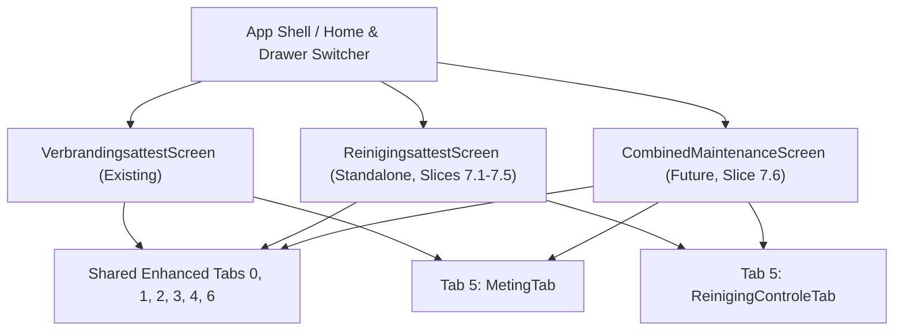
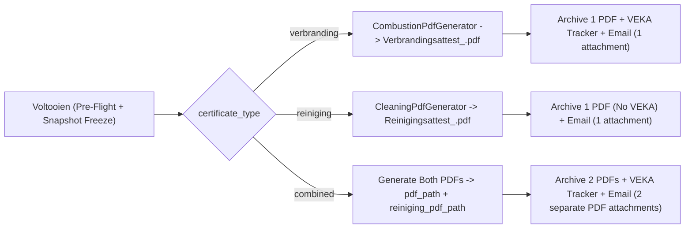

# Reinigingsattest Vlaanderen — Milestone 7 Blueprint (Option B)

> **Living Architecture Spec:** Single source of truth for Milestone 7 (`Reinigingsattest Vlaanderen` + future `Combined Maintenance`).
> **UI/UX Rule:** Existing enhanced `Verbrandingsattest` widgets and `doc/UI_DESIGN_SYSTEM.md` are the **UI/UX source of truth**. Never copy legacy screenshot styling.

---

## 1. Architecture & Pipeline Flowcharts

### 1.1 High-Level Navigation & Option B Architecture

### 1.2 Finalization, Multi-PDF Archiving & Email Pipeline

---

## 2. Tab-Reuse & Delta Matrix (Tabs 0–6)

| Tab | Widget | Reuse Strategy | Exact Domain Delta for `reiniging` (and `combined`) |
| :--- | :--- | :--- | :--- |
| **0 — Data** | `DataTab` | **Untouched** | None (100% identical). |
| **1 — Start** | `StartTab` | **Lightweight mode param** | Header: `"Reinigingsattest Vlaanderen"`. Single activity option: `"Onderhoud centraal stooktoestel"` (omit `"Eerste ingebruikname"`). `Volgnummer Attest` unchanged. |
| **2 — Firma - Technicus** | `FirmaTechnicusTab` | **Lightweight mode param** | Add role toggles: `Erkend technicus` & `Schoorsteenveger`. Hide `analyzerBrand` & `analyzerSerial` in standalone `reiniging` (keep visible in `combined`). Date label: `"Datum reiniging:"`. |
| **3 — Klant** | `KlantTab` | **Untouched** | None (100% identical). |
| **4 — Stooktoestel** | `StooktoestelTab` | **Untouched** | None (100% identical). |
| **5 — Reiniging en controle** | `ReinigingControleTab` *(New)* | **New Tab (UI Design System)** | Replaces `MetingTab` in standalone `reiniging` (both tabs present in `combined`). Tactical selectable tiles inside `BentoMainSection` cards. |
| **6 — Eindbeoordeling** | `EindbeoordelingTab` | **Lightweight mode param** | Standalone `reiniging`: omit `Staat van werking` binary checks and omit `VekaTracker`. Add 3rd multiline box (`Te treffen maatregelen`), add 2nd date (`next_chimney_inspection_date`), and update technician/customer signature labels. |

---

## 3. Tab 5 (`Reiniging en controle`) & Role Validation Spec

### 3.1 Tab 5 Fields (14 Booleans + 1 Conditional Text)

**Card 1: `Reiniging en controle rookgasafvoerkanaal (erkend technicus of schoorsteenveger)`**
1. `vegen van het rookgasafvoerkanaal en verbindingsstukken` (`flue_sweeping`)
2. `nazicht van de goede werking` (`flue_good_operation_check`)
3. `controle van de terugslag door middel van een terugslagmelder` (`flue_backdraft_check`)

**Card 2: `Reiniging van het stooktoestel`**
- **Subgroup A — `Alle toestellen:`**
  4. `andere, namelijk:` (`all_other_checked`) + conditional `DarkTextFormField` (`all_other_text`)
  5. `controle van de verluchting van het stooklokaal` (`all_ventilation_check`)
  6. `controle van de rookgaszijdige dichtheid` (`all_flue_tightness_check`)
- **Subgroup B — `Gasvormige brandstof:` `(erkend technicus)`**
  7. `ontstoffing` (`gas_dust_removal`)
  8. `reiniging van branderbedden en warmtewisselaar (GI) of reinigen van de ketel (GII)` (`gas_burner_bed_exchanger`)
  9. `reiniging van de ventilator en brander` (`gas_fan_burner`)
- **Subgroup C — `Vloeibare brandstof:` `(erkend technicus)`**
  10. `reiniging van de filters` (`liquid_filters`)
  11. `reiniging van de ketel` (`liquid_boiler`)
  12. `reiniging van de brander` (`liquid_burner`)
- **Subgroup D — `Vaste brandstof:` `(geschoold vakman)`**
  13. `nazicht algemene staat` (`solid_general_condition`)
  14. `reiniging inwendige delen warmtebron` (`solid_internal_cleaning`)

### 3.2 Validation & Gating Rules
1. **Conditional `andere, namelijk:` (`all_other_text`):**
   - Rendered only when `all_other_checked == true`.
   - Required when checked (cannot be empty/whitespace).
   - Unchecking immediately clears the controller, unfocuses the keyboard, and prunes `all_other_text` to `null` at the repository/mapper boundary.
2. **Minimum Selection Rule (Tab 5 Finalization):**
   - At least **1 of the 14** cleaning/control checkboxes must be checked to finalize (`Voltooien`).
3. **Technician Qualification Gating (Tab 2 — `Firma - Technicus`):**
   - `GV` / `TV` recognition number is **only required when `Erkend technicus` is checked**.
   - Standalone `Schoorsteenveger` or solid-fuel `geschoold vakman` (`Erkend technicus == false`) must **not** be blocked by empty `GV`/`TV`.
4. **Fuel Subgroup Highlighting (Tab 5):**
   - Highlight/prioritize the subgroup matching `BoilerDraftNotifier.draft.fuelCategory` while preserving any already-checked items if the user switches fuel (Golden Rule #3).

---

## 4. DB v14 Schema & Draft Isolation Contract

### 4.1 Schema Additions (`DatabaseSchema.version = 14`, non-destructive `onUpgrade`)

1. **`technician_profile` (defaults for new visits):**
   - `is_erkend_technicus INTEGER NOT NULL DEFAULT 1`
   - `is_schoorsteenveger INTEGER NOT NULL DEFAULT 0`
2. **`maintenance_visits`:**
   - `certificate_type TEXT NOT NULL DEFAULT 'verbranding'` (`'verbranding' | 'reiniging' | 'combined'`)
   - `technician_role_erkend INTEGER NOT NULL DEFAULT 1`
   - `technician_role_schoorsteenveger INTEGER NOT NULL DEFAULT 0`
   - `remedial_measures_notes TEXT`
   - `next_chimney_inspection_date TEXT`
   - `reiniging_pdf_path TEXT` *(stores Reiniging PDF in `combined` mode alongside `pdf_path`)*
3. **New table `reiniging_controls`:**
   - `id INTEGER PRIMARY KEY AUTOINCREMENT`
   - `visit_id INTEGER NOT NULL UNIQUE` (`FOREIGN KEY (visit_id) REFERENCES maintenance_visits (id) ON DELETE CASCADE`)
   - 14 `INTEGER NOT NULL DEFAULT 0` boolean columns (listed in Section 3.1)
   - `all_other_text TEXT`
   - `created_at TEXT NOT NULL`, `updated_at TEXT NOT NULL`

### 4.2 Draft Isolation & `AppWarmupService` Safety
- **Active Draft Query Contract:** `DraftRepository.getOrCreateActiveDraft({String certificateType = 'verbranding'})` **must** filter by `WHERE is_draft = 1 AND certificate_type = ?`.
- **Zero Collision:** Switching between `Verbrandingsattest`, `Reinigingsattest`, and `Combined` never overwrites or loads another mode's active draft.
- **`AppWarmupService` Safety:** `cachedResult.activeDraft` must only be used when `cachedResult.activeDraft?.certificateType == expectedCertificateType` (otherwise fall back to `getOrCreateActiveDraft(certificateType: expectedCertificateType)`).

---

## 5. End-to-End Lifecycle Details

- **Navigation / Entry Point:** Add a clear mode switcher in the Home/Drawer navigation so the user can launch `Verbrandingsattest`, `Reinigingsattest`, or (in Slice 7.6) `Combined`.
- **Immutable `snapshot_json`:** Freeze `certificate_type`, `reiniging_controls` (all 14 booleans + `all_other_text`), `technician_role_erkend`, `technician_role_schoorsteenveger`, `remedial_measures_notes`, and `next_chimney_inspection_date` on finalization so Historiek previews/re-exports remain immutable even if profile/boiler records change later.
- **PDF Filenames & Archiving:**
  - `Verbrandingsattest_<attestNumber>.pdf` (existing)
  - `Reinigingsattest_<attestNumber>.pdf` (new)
  - In `combined` mode, archive both files (`pdf_path` + `reiniging_pdf_path`).
- **Email Delivery (`EmailJobSpec` & Outbox):**
  - Dynamic Dutch subject and body copy tailored to `certificate_type` (`Verbrandingsattest`, `Reinigingsattest`, or `Verbrandings- en Reinigingsattest`).
  - Support multiple PDF attachments in the outbox job payload so Slice 7.6 sends **1 email with 2 separate PDF attachments**.
- **Historiek:**
  - Display a distinct type badge (`Verbranding`, `Reiniging`, `Gecombineerd`) on visit cards and support filtering.
  - Hide VEKA status/actions on standalone `reiniging` visits (VEKA applies only to `verbranding` and `combined`).

---

## 6. Slice Checklist (7.1 – 7.6)

- [x] **Slice 7.1 — Schema & Data Layer:** DB v14 migration, `ReinigingControlsDraft` model, `DraftVisit` / `EindbeoordelingDraft` / `TechnicianProfile` extensions, `ReinigingRepository`, draft isolation by `certificate_type`, and unit tests.
- [x] **Slice 7.2 — Tab 5 (`Reiniging en controle`):** `ReinigingDictionary`, `ReinigingControleTab` + tactical checklist tiles, conditional `andere, namelijk:` input + pruning, and widget tests.
- [x] **Slice 7.3 — Tabs 1/2/6 Deltas & `ReinigingsattestScreen`:** Lightweight mode flags on `StartTab`, `FirmaTechnicusTab`, `EindbeoordelingTab`, `GV`/`TV` role-based validation, standalone `ReinigingsattestScreen` (isolated `'reiniging'` draft, locked Start card, role-gated `GV`/`TV`, fuel-gated Tab 5, dual dates + 3 note fields on Tab 6), and navigation entry point.
- [x] **Slice 7.4 — Reinigingsattest PDF Export:** `PdfCleaningData` + `PdfVisitLoader` + `PdfDataMapper` extensions, `CleaningPdfGenerator` (reusing `PdfKlantBuilder`, `PdfToestelKenmerkenBuilder`, `PdfToestelApparaatBuilder`, `pdf_components.dart`, and `pdf_theme_tokens.dart` with modular `cleaning_*.dart` builders matching `Reinigingsattest_l0esgo.docx` 1:1 on a single A4 page), and `Reinigingsattest_<nr>.pdf` live preview & device save (`Reinigingsattest Voltooien` remains stubbed for Slice 7.5).

### 6.1 Universal UI & Quality Guardrails
- `tool/check_gates.ps1` **Gate 1D** (`tool/gate_rules.json`) enforces formatting, static analysis, `<= 250`-line Dart files, zero raw `showSnackBar`, zero unannotated `pw.Spacer(`, zero `_buildX` widget helpers, and zero skipped tests.
- `test/helpers/responsive_layout_guard.dart` (`expectNoOverflowOrShrunkLabels`) guards narrow phone (`360x800`) and tablet (`768x1024`) viewports against `RenderFlex` overflows and `FittedBox` label shrinkage.
- [ ] **Slice 7.5 — Finalization, Email & Historiek:** Visit finalization snapshot freeze, dynamic Dutch `EmailJobSpec` for Reinigingsattest, and Historiek type badges/filtering (VEKA hidden for standalone Reiniging).
- [ ] **Slice 7.6 — Combined Maintenance Mode (Option B):** Shared 8-tab workflow (`MetingTab` + `ReinigingControleTab`), dual PDF generation/archiving (`pdf_path` + `reiniging_pdf_path`), and 1 email with 2 separate PDF attachments.
